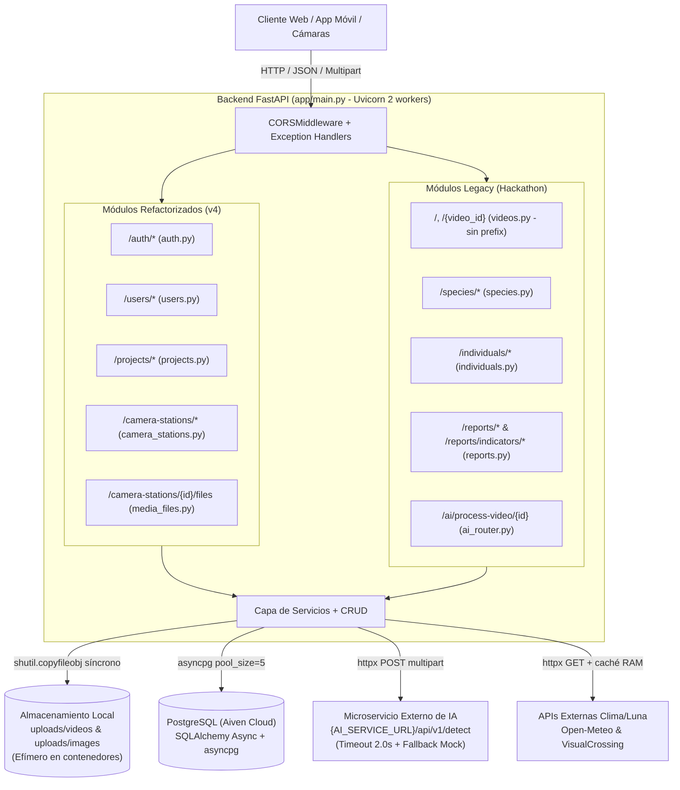

# 1. Arquitectura y Estructura del Proyecto (`BACKWWF`)

> [!NOTE]
> Este documento forma parte de la auditoría técnica de [[01_Arquitectura_y_Estructura]] | [[02_Endpoints_y_Estado_Funcional]] | [[03_Flujo_Datos_IA_y_BaseDeDatos]] | [[04_Seguridad_Autenticacion_y_Firewall]] | [[05_Analisis_Mejoras_Criticas_y_Seguridad]] | [[06_Matriz_Base_Para_TDR]].

---

## 1.1 Árbol del Proyecto y Responsabilidad Real de Módulos

El repositorio corresponde a un backend en **Python 3.11 + FastAPI** construido originalmente en una hackathon y evolucionado parcialmente hacia una versión `4.0.0` (visible en `app/main.py` y `Dockerfile`). A continuación se detalla el árbol real de archivos relevantes (excluyendo entornos virtuales `app/venv/`, cachés `__pycache__/` y archivos temporales).

```text
BACKWWF/
├── .env                          # Variables de entorno locales (ignorado en git)
├── .env.example                  # Plantilla de variables de entorno
├── .gitignore                    # Reglas de exclusión de Git
├── alembic.ini                   # Configuración de Alembic (apunta a postgresql+asyncpg local por defecto)
├── check_db.py                   # Script suelto de verificación de conexión a PostgreSQL (Aiven)
├── digitalocean.yaml             # App Spec de despliegue para DigitalOcean App Platform
├── docker-compose.yml            # Orquestación local (API + volumen ./uploads)
├── Dockerfile                    # Build multi-stage (python:3.11-slim, ffmpeg, curl, usuario appuser)
├── koyeb.yml                     # Configuración alternativa de despliegue en Koyeb
├── pytest.ini                    # Configuración de Pytest
├── requirements.txt              # Dependencias Python (FastAPI 0.128.8, SQLAlchemy 2.0.23, asyncpg, httpx)
├── seed_db.py / seed_massive.py  # Scripts de carga inicial de datos de prueba
├── uploads/                      # Almacenamiento local en disco para videos e imágenes subidos
├── migrations/
│   ├── env.py                    # Entorno asíncrono de Alembic conectado a settings.DATABASE_URL y Base.metadata
│   └── versions/                 # ⚠️ Solo contiene .gitkeep (sin revisiones de migración generadas)
├── tests/                        # Suite de pruebas de estrés, seguridad, handlers y fases 3-5
└── app/
    ├── main.py                   # Punto de entrada FastAPI, lifespan, CORS, OpenAPI, exception handlers y routers
    ├── api/
    │   ├── deps.py               # Inyección de dependencias (get_db, get_current_user, get_anon_session_id, servicios)
    │   └── v1/                   # Endpoints HTTP organizados por dominio (mezcla de estilos v1 y v4)
    │       ├── auth.py           # /auth/* (register, login, refresh, me)
    │       ├── users.py          # /users/* (claim, history, CRUD básico)
    │       ├── projects.py       # /projects/* (CRUD, asociación N:M estaciones, summary, colaboradores)
    │       ├── camera_stations.py# /camera-stations/* (CRUD, summary)
    │       ├── media_files.py    # /camera-stations/{id}/files y /camera-stations/files/{id}
    │       ├── videos.py         # ⚠️ Router sin prefix (/ , /{video_id}) - ingesta legacy de videos
    │       ├── species.py        # /species/* (listado, /data enriquecido, verificación humana, delete)
    │       ├── individuals.py    # /individuals/* (CRUD básico de individuos y verificación)
    │       ├── reports.py        # /reports/* e /reports/indicators/* (10 endpoints de indicadores ecológicos)
    │       └── ai_router.py      # /ai/process-video/{video_id} (reprocesamiento IA legacy)
    ├── core/
    │   ├── config.py             # Pydantic BaseSettings (.env, JWT secrets, DATABASE_URL, AI_SERVICE_URL, CORS)
    │   ├── enums.py              # Enumeraciones (CameraStationStatus, ProjectStatus, MediaType, EnvironmentMode, etc.)
    │   └── security.py           # Hashing bcrypt y generación/validación de JWT (PyJWT HS256)
    ├── db/
    │   └── session.py            # Motor SQLAlchemy Async (asyncpg), pool_size=5, max_overflow=10, get_db()
    ├── interfaces/               # Contratos ABC para capa de servicios (IAuthService, IUserService, etc.)
    ├── models/                   # Modelos ORM SQLAlchemy 2.0 (Base, BaseEntity, User, Project, CameraStation, etc.)
    ├── schemas/                  # Esquemas Pydantic v2 de entrada/salida y StandardResponse
    ├── crud/                     # Capa genérica CRUDBase y repositorios específicos (project, camera_station, species)
    └── services/                 # Lógica de negocio, integración IA, FFmpeg, clima/luna e indicadores ecológicos
        ├── auth_service.py       # Registro, login, refresh token y perfil
        ├── user_service.py       # Reclamo de sesiones anónimas e historial
        ├── project_service.py    # Gestión de proyectos, relaciones N:M y resúmenes taxonómicos
        ├── station_service.py    # Gestión de estaciones de cámara y resúmenes taxonómicos
        ├── media_service.py      # Ingesta de imágenes/videos en MediaFile + llamada a IA + batch insert Species
        ├── ai_service.py         # Cliente HTTP hacia microservicio externo de IA + parse_taxonomy() + fallback mock
        ├── video_service.py      # Extracción de metadatos con ffmpeg.probe (⚠️ ruta FFmpeg Windows hardcodeada)
        ├── species_data_service.py # Enriquecimiento (Haversine, velocidad, eventos indep., Open-Meteo, VisualCrossing)
        └── indicators_service.py # Cálculo estadístico ecológico (RAI, Shannon, Simpson, Weckel, ocupación, gremios)
```

---

## 1.2 Arquitectura General (Flujo de Capas)

El backend presenta una **arquitectura híbrida (transición incompleta entre MVP de hackathon y arquitectura en capas)**:

1. **Punto de entrada ASGI (`app/main.py`):**
   - Instancia `FastAPI(version="4.0.0", lifespan=lifespan)`. El `lifespan` únicamente ejecuta `await engine.dispose()` al apagar.
   - Registra tres manejadores globales de excepciones (`StarletteHTTPException`, `RequestValidationError`, `Exception`) que envuelven los errores en la estructura `{status: "error", data: None, message: ...}`.
   - Configura `CORSMiddleware` y un esquema `custom_openapi` con `BearerAuth`.
   - Expone `/` y `/health` (este último ejecuta `SELECT 1` contra PostgreSQL) y monta los 10 routers de `app/api/v1/`.

2. **Capa de Transporte e Inyección (`app/api/deps.py` y `app/api/v1/`):**
   - **Rama Refactorizada (v4):** `auth.py`, `users.py` (parcial), `projects.py`, `camera_stations.py` y `media_files.py` delegan en interfaces (`IAuthService`, `IUserService`, `IProjectService`, `IStationService`, `IMediaService`) inyectadas vía `Depends(...)` y responden usando `StandardResponse`.
   - **Rama Legacy (Hackathon):** `videos.py`, `species.py`, `individuals.py`, `reports.py` y `ai_router.py` acceden directamente a `app/crud/` y servicios estáticos/funciones sueltas, devolviendo modelos Pydantic directos sin `StandardResponse`.

3. **Capa de Negocio vs. Capa de Acceso a Datos (`app/services/` y `app/crud/`):**
   - Los servicios refactorizados (`ProjectService`, `StationService`, `MediaService`, `AuthService`, `UserService`) **no utilizan `app/crud/`**; ejecutan consultas `select()` / `update()` de SQLAlchemy 2.0 directamente contra `AsyncSession`.
   - Los routers legacy sí utilizan `app/crud/base.py` (`CRUDBase`) y los CRUD especializados (`crud_project.py`, `crud_camera_station.py`, `crud_species.py`).

---

## 1.3 Evaluación de Estándares de la Industria

| Estándar / Principio | Estado | Evidencia en el Código |
| :--- | :---: | :--- |
| **Clean Architecture / Separación de Capas** | ⚠️ Parcial | Existen interfaces en `app/interfaces/` y servicios desacoplados en `auth`, `projects`, `camera_stations`, `media_files`. Sin embargo, `services/` importa directamente modelos ORM y `HTTPException` de FastAPI (acoplamiento al framework web), y los módulos legacy saltan la capa de servicio. |
| **Principios SOLID** | ⚠️ Parcial | **DIP** aplicado parcialmente mediante `I*Service` en `app/api/deps.py`, pero `deps.py` retorna singletons concretos globales. **SRP** se rompe en `media_service.py` y `videos.py` (validación, I/O en disco, BD, IA y telemetría en una sola función) y en `species_data_service.py` (cálculos biológicos + cliente HTTP clima/luna + caché global). |
| **Diseño RESTful y Versionado** | ❌ Roto | `settings.API_V1_STR` (`/api/v1`) está definido en `app/core/config.py`, pero **no se usa** al registrar los routers en `app/main.py` (los endpoints viven en `/auth`, `/projects`, etc., contradiciendo los docstrings que dicen `/api/v1/...`). Peor aún, `app/api/v1/videos.py` no define `prefix` en `APIRouter()`, montando `POST /`, `GET /{video_id}` y `DELETE /{video_id}` en la raíz, y su `GET /` queda sombreado por `root()` en `app/main.py`. |
| **Tipado y Validación con Pydantic v2** | ✅ Mayormente Cumplido | Uso consistente de `BaseModel`, `ConfigDict(from_attributes=True)`, `BaseSettings` y `Enum` en `app/core/enums.py`. Brecha: los servicios refactorizados devuelven `dict[str, Any]` sin tipado estricto hacia `StandardResponse[T]`. |
| **Asincronía (`async/await`)** | ❌ Roto en puntos críticos | Base de datos (`asyncpg`) y `httpx.AsyncClient` son asíncronos, pero la escritura de archivos en `app/services/media_service.py` (L109-110) y `app/api/v1/videos.py` (L74-75) usa `open()` + `shutil.copyfileobj()` síncrono, bloqueando el Event Loop. `ai_service.py` (L87) también abre el archivo de forma síncrona. |
| **PEP 8 y Calidad de Código** | ⚠️ Parcial | Nombres descriptivos y docstrings claros en módulos v4, pero hay mezcla de idiomas (inglés/español en nombres de campos como `colaborators`, `institucion`, `dias_activos`, `periodoweckel`), imports sin usar, `print()` en lugar de `logger` en `species_data_service.py`, y rutas locales de Windows hardcodeadas en `video_service.py`. |

---

## 1.4 Diagrama de Arquitectura Actual


