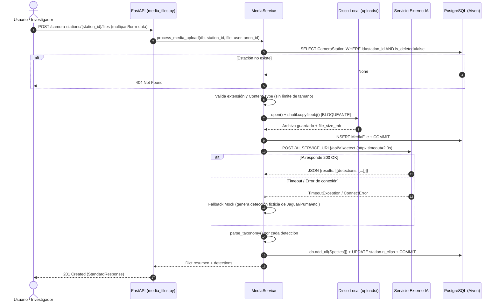
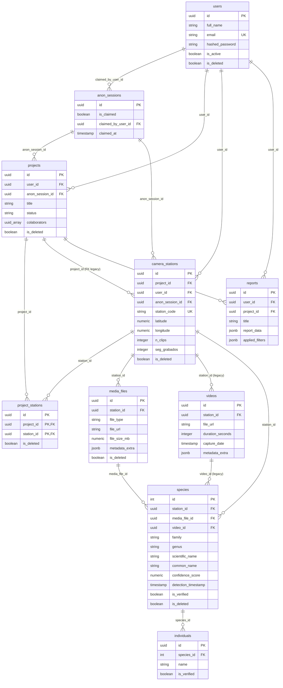

# 3. Flujo de Datos, Integración con IA y Base de Datos

> [!NOTE]
> Documento anterior: [[02_Endpoints_y_Estado_Funcional]] | Siguiente: [[04_Seguridad_Autenticacion_y_Firewall]]

---

## 3.1 Integración con el Servicio Externo de IA (`app/services/ai_service.py`)

La comunicación con el modelo externo de visión por computadora se centraliza en `analyze_media_with_ai(file_path, file_type)` (con alias `analyze_video_with_external_ai`):

* **Librería HTTP:** `httpx.AsyncClient` (`httpx==0.27.0`).
* **Endpoint destino:** `POST {AI_SERVICE_URL}/api/v1/detect`.
  * *Inconsistencia de configuración:* `app/services/ai_service.py` (L12) usa por defecto `http://localhost:8000`, `app/core/config.py` (L25) usa `http://localhost:8081`, y `app/api/v1/videos.py` (L129) usa `http://localhost:8080`.
* **Envío de Payload:** Se abre el archivo desde disco con `with open(file_path, "rb") as media_file:` (lectura síncrona) y se envía como `multipart/form-data` (`files={"file": (filename, media_file, mime_type)}`). No se utiliza streaming asíncrono por chunks ni URLs prefirmadas (S3/Object Storage).
* **Timeouts y Reintentos:**
  * `timeout=2.0` segundos (`app/services/ai_service.py` L86). Para transferencia e inferencia de videos de cámaras trampa, 2 segundos es inviable en producción.
  * **Reintentos:** **No implementado.** No hay backoff exponencial ni circuit breaker.
* **Manejo de Fallos (Comportamiento Mock Peligroso):**
  * Ante `httpx.ConnectError`, `httpx.ConnectTimeout` o `httpx.TimeoutException` (L98-123), la función **no lanza error ni marca el archivo como pendiente**; en su lugar fabrica una detección ficticia con `confidence: 0.9450` basándose en el nombre del archivo (si no dice `puma`, `tapir` u `ocelote`, **siempre retorna `Felidae;Panthera;Panthera onca;Jaguar`**).
  * Ante otras excepciones (L125-131), retorna `{"status": "partial", "results": [], "error": str(e)}`.
* **Parseo Taxonómico:** `parse_taxonomy(species_raw)` divide la cadena por `;` en hasta 4 niveles (`family`, `genus`, `scientific_name`, `common_name`).

---

## 3.2 Persistencia y Base de Datos (`app/db/session.py` y `app/models/`)

* **Motor y Driver:** PostgreSQL (alojado en Aiven Cloud según `digitalocean.yaml` y `check_db.py`) accedido mediante **SQLAlchemy 2.0.23** con driver asíncrono **`asyncpg==0.29.0`**.
* **Pool de Conexiones (`app/db/session.py`):** `pool_pre_ping=True`, `pool_size=5`, `max_overflow=10`, `pool_timeout=30.0`, `pool_recycle=1800`, `expire_on_commit=False`.
* **Migraciones (`migrations/`):** Alembic está configurado en `migrations/env.py` en modo asíncrono apuntando a `Base.metadata`, pero **`migrations/versions/` está vacío** (solo contiene `.gitkeep`). No hay historial de migraciones versionado.
* **Anomalías de Modelado ORM:**
  1. **Duplicidad de tablas multimedia:** Coexisten `videos` (`app/models/video.py`) y `media_files` (`app/models/media_file.py`), ambas referenciadas por `species` (`video_id` y `media_file_id`).
  2. **Herencia inconsistente de `BaseEntity`:** `User`, `AnonSession`, `Project`, `CameraStation`, `ProjectStation` y `MediaFile` heredan de `BaseEntity` (auditoría + soft delete). `Video`, `Individual` y `Report` heredan de `Base` (sin `is_deleted`, `deleted_at` ni `updated_at`). `Species` hereda de `Base` y duplica manualmente las columnas de soft delete con PK `Integer` autoincremental.
  3. **Clave primaria compuesta anómala en `ProjectStation` (`app/models/project_station.py`):** Hereda `id` (`primary_key=True`) de `BaseEntity` y además marca `project_id` y `station_id` como `primary_key=True`, generando una PK de 3 columnas `(id, project_id, station_id)`.
  4. **Carga ansiosa en cascada (`lazy="selectin"`):** `User`, `Project`, `CameraStation`, `ProjectStation`, `MediaFile` y `Report` definen `lazy="selectin"` en múltiples relaciones bidireccionales, lo que dispara consultas adicionales automáticas en cada lectura.

---

## 3.3 Diagrama de Secuencia Extremo a Extremo (Flujo v4 `media_files.py`)

---

## 3.4 Diagrama Entidad-Relación (ERD) Actual

