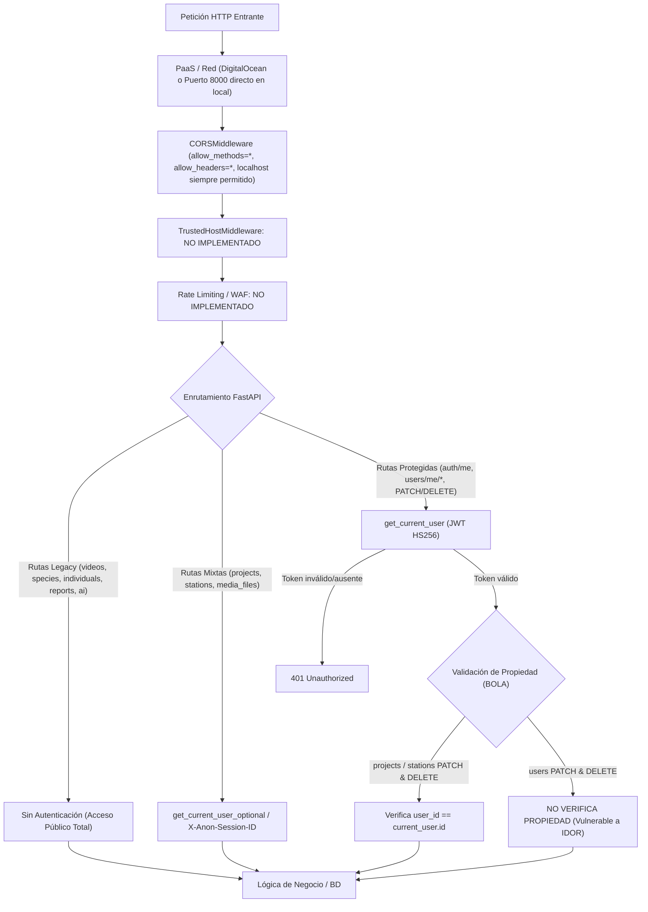

# 4. Seguridad, Autenticación y Configuración de Red / Firewall

> [!NOTE]
> Documento anterior: [[03_Flujo_Datos_IA_y_BaseDeDatos]] | Siguiente: [[05_Analisis_Mejoras_Criticas_y_Seguridad]]

---

## 4.1 Autenticación y Autorización

### Mecanismo Implementado (`app/core/security.py` y `app/api/deps.py`)
* **Hashing de Contraseñas:** `bcrypt` directo (`bcrypt.hashpw` con `gensalt()` y `bcrypt.checkpw`).
* **Tokens JWT:** `PyJWT` (`jwt.encode` / `jwt.decode`) con algoritmo `HS256`.
  * `create_access_token`: expiración configurable (`ACCESS_TOKEN_EXPIRE_MINUTES=30`), claim `type="access"`, firmado con `settings.SECRET_KEY`.
  * `create_refresh_token`: expiración configurable (`REFRESH_TOKEN_EXPIRE_DAYS=7`), claim `type="refresh"`, firmado con `settings.REFRESH_SECRET_KEY`.
  * *Brecha:* No existe lista de revocación / blacklist de tokens (logout o rotación estricta de refresh tokens), ni roles/permisos (RBAC).
* **Dependencias de Seguridad en `app/api/deps.py`:**
  * `get_current_user`: exige cabecera `Authorization: Bearer <token>`, valida firma, `type == "access"`, `sub` UUID, existencia en BD (`is_deleted == False`) y `is_active == True`.
  * `get_current_user_optional`: retorna `User` si el token es válido o `None` si falta o falla.
  * `get_anon_session_id`: lee `X-Anon-Session-ID` o genera un `UUIDv4` nuevo e inyecta el header en la respuesta.

### Matriz de Protección de Rutas
| Módulo / Archivo | Rutas Protegidas (JWT + Propiedad) | Rutas con Auth Incompleta (Sin Propiedad / BOLA) | Rutas Expuestas al Público (Sin Auth) |
| :--- | :--- | :--- | :--- |
| `app/api/v1/auth.py` | `GET /auth/me` | — | `POST /auth/register`, `login`, `refresh` (esperado) |
| `app/api/v1/users.py` | `POST /users/me/claim`, `GET /users/me/history` | `PATCH /users/{user_id}`, `DELETE /users/{user_id}` (**No validan `user_id == current_user.id`**) | `GET /users/`, `GET /users/{user_id}` (**Expuesto**) |
| `app/api/v1/projects.py` | `PATCH /projects/{id}`, `DELETE /projects/{id}`, `POST /projects/{id}/collaborators` | `POST /projects/` (permite anónimos) | `GET /projects/*`, `POST/DELETE /projects/{id}/stations` (**Expuesto a anónimos sin validar dueño**) |
| `app/api/v1/camera_stations.py` | `PATCH /camera-stations/{id}`, `DELETE /camera-stations/{id}` | `POST /camera-stations/` (permite anónimos) | `GET /camera-stations/*` |
| `app/api/v1/media_files.py` | — | `POST /camera-stations/{id}/files` (permite anónimos) | `GET /camera-stations/{id}/files`, `GET /camera-stations/files/{id}` |
| `app/api/v1/videos.py` | **Ninguna** | — | `POST /`, `GET /{video_id}`, `DELETE /{video_id}` (**Totalmente Expuesto**) |
| `app/api/v1/species.py` | **Ninguna** | — | `GET /species/*`, `POST /species/{id}/verify`, `DELETE /species/{id}` (**Totalmente Expuesto**) |
| `app/api/v1/individuals.py` | **Ninguna** | — | `POST/GET/DELETE /individuals/*`, `POST /individuals/{id}/verify` (**Totalmente Expuesto**) |
| `app/api/v1/reports.py` | **Ninguna** | — | `POST/GET/DELETE /reports/*`, `GET /reports/indicators/*` (**Totalmente Expuesto**) |
| `app/api/v1/ai_router.py` | **Ninguna** | — | `POST /ai/process-video/{video_id}` (**Totalmente Expuesto**) |

---

## 4.2 Configuración de Red, CORS, Contenedores y Firewall

* **CORS (`app/main.py` L106-114 y `app/core/config.py` L36-59):**
  * `CORSMiddleware` habilitado con `allow_credentials=True`, `allow_methods=["*"]`, `allow_headers=["*"]`, `expose_headers=["Content-Disposition", "X-Anon-Session-ID"]`.
  * **Problema:** `settings.cors_origins` inyecta incondicionalmente orígenes locales (`http://localhost:5173`, `http://127.0.0.1:5173`, `http://localhost:3000`, `http://127.0.0.1:3000`) incluso cuando `ENVIRONMENT == "production"`.
* **TrustedHostMiddleware:** **No implementado.** La aplicación acepta cualquier cabecera `Host`.
* **Rate Limiting / Throttling:** **No implementado.** No existe `slowapi`, `fastapi-limiter` ni límites de peticiones por IP o usuario.
* **Security Headers (HSTS, CSP, X-Frame-Options, X-Content-Type-Options):** **No implementado.**
* **Reverse Proxy / WAF / Firewall a nivel de aplicación o Compose:** **No implementado.** `docker-compose.yml` expone directamente el puerto `8000:8000` de Uvicorn sin Nginx, Traefik ni Caddy delante.
* **Contenedor (`Dockerfile`):**
  * Multi-stage sobre `python:3.11-slim`.
  * Buena práctica: crea y ejecuta bajo usuario no-root `appuser` (`USER appuser`, L47-50).
  * Expone puerto `8000` y ejecuta `uvicorn app.main:app --host 0.0.0.0 --port 8000 --workers 2 --loop uvloop --no-access-log`.
* **Despliegue PaaS (`digitalocean.yaml` y `koyeb.yml`):**
  * El TLS/HTTPS y firewall perimetral quedan delegados al proveedor PaaS (DigitalOcean App Platform o Koyeb).
  * En `digitalocean.yaml`, `AI_SERVICE_URL` apunta por HTTP plano sin TLS (`http://206.81.8.110`) y el healthcheck apunta a `/docs` en lugar de `/health`.

---

## 4.3 Diagrama de Flujo de Seguridad Actual (HTTP Request Pipeline)

