# 7. Brechas de Arquitectura y Contratos Oficiales (Análisis Delta)

> [!NOTE]
> Documento anterior: [[06_Matriz_Base_Para_TDR]] | Siguiente: [[08_Plan_Remediacion_Seguridad_y_Deuda]] | Skills compactas: [[wwf-backend-standards]] · [[wwf-api-contracts]]

Este documento contrasta el código real de `BACKWWF` contra los 4 documentos normativos: `ESTANDARES_BACKEND_IA.md`, `API_BACK_FRONT.md`, `API_IA_BACK.md` y `PAQUETE_ESCRITORIO.md`.

---

## 7.1 Cumplimiento de Estándares (`ESTANDARES_BACKEND_IA.md`)

| Dimensión del Estándar | Requisito Oficial (`ESTANDARES_BACKEND_IA.md`) | Estado Real en `BACKWWF` | Brecha / Acción Requerida |
| :--- | :--- | :--- | :--- |
| **Estructura de Capas (§2.1)** | `api/v1/router.py`, `core/{errors,logging,middleware,responses}.py`, `repositories/` (sin `commit`), `integrations/{ai_client,storage,queue,email}`, `worker/`, `reports/`, `db/uow.py`. | Mezcla de servicios v4 (`services/` consultando BD directo y lanzando `HTTPException`) + `crud/` (hace `commit()` en `CRUDBase`) + routers legacy (`videos.py`, `species.py`, `individuals.py`, `reports.py`, `ai_router.py`). | Crear `repositories/`, `integrations/`, `worker/` (`arq`), `reports/` y `db/uow.py`. Sacar `HTTPException` y queries directas de `services/`. Eliminar módulos legacy. |
| **Prefijo y Convenciones (§3)** | Prefijo global `/api/v1` (`router.py`); paginación `?page=&page_size=` con `meta.pagination`; fechas UTC con `Z` (y `captured_at` local sin zona). | `settings.API_V1_STR` existe en `config.py` pero **no se usa** en `app/main.py`. Paginación usa `skip`/`limit`. `videos.py` no tiene `prefix` y monta en `/`. | Montar todo bajo `/api/v1`. Migrar a `page`/`page_size`. Reemplazar `/users/*`, `/videos/*`, `/media-files/*`, `/species/*`, `/individuals/*`, `/reports/indicators/*`, `/ai/*`. |
| **Formato de Respuesta (§4)** | Envoltura única `ApiResponse[T]`: `{status, data, message, error, meta}` con `meta.{request_id, timestamp, pagination, warnings}`. | `app/schemas/response_wrapper.py` define `StandardResponse {status, data, message}` (faltan `error` y `meta`). Routers legacy devuelven modelos crudos sin envoltura. | Crear `app/core/responses.py` (`ApiResponse`, `ok()`, `paginated()`) manteniendo compatibilidad con `{status, data, message}` y añadiendo `error` y `meta`. |
| **Manejo de Errores (§5 y §6)** | Jerarquía `AppError` con `error.code` estable del catálogo (§6.1) y `details`. Prohibido `HTTPException` con texto libre y prohibido exponer `str(exc)` en 500. | Se lanza `HTTPException(detail="...")` con texto libre en servicios/routers. `app/main.py` (L99) retorna `f"Error interno del servidor: {str(exc)}"` en 500. | Crear `app/core/errors.py` con `AppError` y los códigos del catálogo. Actualizar los 5 handlers globales en `app/main.py` (`AppError`, `RequestValidationError`, `StarletteHTTPException`, `SQLAlchemyError`, `Exception`). |
| **Logs y Correlación (§7)** | Logs JSON en 1 línea (`structlog`/`python-json-logger`) a `stdout`, `X-Request-ID`, `flow`, `step`, `duration_ms`. Prohibido `print()` y loguear JSON completo de IA o secretos. | `logging` con f-strings sin JSON ni `request_id`. `species_data_service.py` (L115, L196) usa `print()`. `videos.py` (L122) imprime el JSON completo de la IA. | Implementar `app/core/logging.py` + `RequestContextMiddleware` + `AccessLogMiddleware` (usando `uvicorn --no-access-log` ya presente en `Dockerfile` L65). |
| **Configuración (§8)** | Un solo `Settings` en `config.py` validado al arrancar (falla con `CRITICAL` si `SECRET_KEY < 32 bytes` o falta variable). Prohibido `os.getenv`/`load_dotenv` fuera de `config.py`. Tabla `system_settings`. | `ai_service.py` (L10, L12) y `videos.py` (L12, L21, L129) usan `load_dotenv()`/`os.getenv()`. `config.py` (L16-17) tiene secretos débiles por defecto. Clave de VisualCrossing hardcodeada en `species_data_service.py` (L180). Ruta Windows en `video_service.py` (L6). | Centralizar las ~30 variables nuevas en `app/core/config.py` con validadores estrictos al arranque. Crear tabla `system_settings` y `SettingsService`. |
| **Almacenamiento (§9)** | **No guardar archivos originales** tras clasificar: subir a temporal `/data/tmp-uploads`, procesar en worker, guardar solo fotograma JPEG (`evidence_key`: `evidence/{yyyy}/{mm}/{id}.jpg`) vía `StorageBackend` (`LocalStorage`/`S3Storage`), servir protegido en `/classifications/{id}/evidence`. | `media_service.py` (L103-110) y `videos.py` (L66-75) copian el **archivo completo original** a `uploads/videos` o `uploads/images` con `shutil.copyfileobj` síncrono (bloquea Event Loop) y guardan la ruta absoluta local en BD (`file_url`). | Reemplazar `uploads/` + `shutil.copyfileobj` por escritura asíncrona en chunks a `TMP_UPLOAD_PATH`, protocolo `StorageBackend` para fotogramas JPEG validados con Pillow, y limpieza en `finally`/worker. |
| **Calidad y Testing (§10-§11)** | `ruff`, `mypy`, `pre-commit`, CI, tests por flujo y validación de contrato compartido `ai_contract.py`. | Sin `ruff`, `mypy`, `pre-commit` ni CI. | Incorporar `pyproject.toml` con `ruff` + `mypy`, `pre-commit` y tests de contrato Pydantic contra `API_IA_BACK.md` y `PAQUETE_ESCRITORIO.md`. |

---

## 7.2 Matriz Completa de los 44 Endpoints (`API_BACK_FRONT.md`)

> [!IMPORTANT]
> Todos los endpoints del contrato van bajo `/api/v1`. En el código actual de `BACKWWF`, **ningún router tiene el prefijo `/api/v1`**; cuando un endpoint "Existe con diferencias", se indica tanto la ruta actual como los cambios estructurales exigidos.

### Dominio 1: Autenticación, Sesiones Anónimas y Sistema (#1 – #12)
| # | Método y Ruta Contrato (`/api/v1/...`) | Estado en `BACKWWF` | Cambios Exactos en Schemas, Modelos y Permisos |
| :---: | :--- | :--- | :--- |
| **1** | `POST /auth/register` | **Existe con diferencias de ruta/payload** (`/auth/register`) | Eliminar `sexo` (no está en contrato); exigir `password` ≥ 8 chars con letra+número (`AUTH_WEAK_PASSWORD`); devolver `409 AUTH_EMAIL_TAKEN`; aceptar `X-Anon-Token` y retornar `anon_session: {has_data, counts}`; incluir `role` y `last_login_at` en `User` y `expires_in` en `AuthTokens`. |
| **2** | `POST /auth/login` | **Existe con diferencias de ruta/payload** (`/auth/login`) | Añadir `rate limit` (10/min IP, 5/min admin -> `RATE_LIMITED`); aceptar `X-Anon-Token` y retornar `anon_session`; usar código `AUTH_INVALID_CREDENTIALS` (401) / `ACCOUNT_DISABLED` (403); actualizar `User.last_login_at`. |
| **3** | `POST /auth/refresh` | **Existe con diferencias de ruta/payload** (`/auth/refresh`) | Envolver respuesta en `{"tokens": AuthTokens}`; crear tabla `refresh_tokens` (hash, `revoked_at`, `expires_at`) para rotación estricta y detección de reuso (revocar todos los tokens del usuario). |
| **4** | `POST /auth/logout` | **No existe** | Crear endpoint con Bearer Auth; recibe `{refresh_token}`, marca el token como revocado en BD (`refresh_tokens`), retorna `data: null`. |
| **5** | `GET /auth/me` · `PATCH /auth/me` | **Existe con diferencias** (`GET /auth/me` existe; `PATCH /auth/me` **No existe**) | `GET`: alinear schema `User` (`institution`, `role`, `last_login_at`). `PATCH`: implementar actualización exclusiva de `full_name` e `institution` (prohibido cambiar `email` o `role`). Reemplaza `PATCH /users/{id}`. |
| **6** | `POST /auth/me/password` | **No existe** | Crear endpoint Bearer; valida `current_password` (`AUTH_INVALID_CREDENTIALS`), fuerza de `new_password` (`AUTH_WEAK_PASSWORD`), actualiza hash y revoca otros `refresh_tokens`. |
| **6b** | `POST /auth/password/forgot` · `GET /auth/password/reset/validate` · `POST /auth/password/reset` | **No existe** | Crear tabla `password_reset_tokens` (hash SHA-256, TTL 30 min, uso único); implementar límites por correo/IP/global (`EMAIL_DAILY_CAP`, `EMAIL_MONTHLY_CAP`); encolar envío en `worker` (Resend) para respuesta de tiempo constante. |
| **7** | `POST /anon-sessions` | **No existe** | Hoy se genera un UUID en memoria en `deps.get_anon_session_id` sin endpoint propio ni rate limit. Crear endpoint público (5/hora por IP) que emita `anon_token` (43 chars), guarde su **hash** en `anon_sessions` con `expires_at` (24h) y retorne `{anon_token, expires_at, data_retention}`. |
| **8** | `GET /anon-sessions/current` | **No existe** | Autenticado con `X-Anon-Token`; retorna `status`, `expires_at`, `data_retention`, `counts` y `limits` (`max_files: 50`, `max_camera_stations: 5`). Error `401 ANON_SESSION_EXPIRED`. |
| **9** | `POST /anon-sessions/claim` | **Reemplaza router legacy** (`POST /users/me/claim`) | Exigir `Bearer` + `X-Anon-Token` (no en el body); migrar también `classifications` (antes no existía); manejar colisión de `code` de cámaras renombrando a `<code>-2` y retornando `renamed_camera_stations`; manejar `409 ANON_SESSION_ALREADY_CLAIMED`. |
| **10** | `POST /anon-sessions/current/close` | **No existe** | Autenticado con `X-Anon-Token`; expira la sesión inmediatamente y retorna `{status: "expired", data_retained}` según `system_settings.anon_data_retention`. |
| **11** | `GET /config/public` | **No existe** | Endpoint sin auth que expone límites de media (`max_file_mb: 300`, `max_video_seconds: 15`, extensiones), límites anónimos, configuración de subida/cola, `password_recovery.enabled`, mapa (`-17.7833,-63.1821`), `import` y `app_version`. |
| **12** | `GET /health` · `GET /health/ready` | **Existe con diferencias** (`GET /health` existe; `/health/ready` **No existe**) | `/health` debe ser ligero sin BD (`{status: "ok", version}`); `/health/ready` verifica `database`, `ai` (`GET {AI_BASE_URL}/health`), `redis` y `storage`, devolviendo `503` si alguno falla. |

### Dominio 2: Cámaras Trampa (#13 – #15d)
| # | Método y Ruta Contrato (`/api/v1/...`) | Estado en `BACKWWF` | Cambios Exactos en Schemas, Modelos y Permisos |
| :---: | :--- | :--- | :--- |
| **13** | `GET /camera-stations` · `POST /camera-stations` | **Existe con diferencias de ruta/payload** (`/camera-stations/`) | **Modelo `CameraStation`:** renombrar `station_code`->`code`, `location_name`->`name`, `deployment_date`->`deployed_at` (DateTime local), `retrieval_date`->`retrieved_at`, añadir `still_installed`, `observations`, `visibility` (`public`/`private`), `previous_camera_station_id`, `version` (optimistic locking); quitar `dias_activos`, `n_clips`, `seg_grabados`, `horas_grabadas`, `project_id` FK. **GET:** agregar filtros `scope`, `view` (`full`/`map`), `project_id`, `bbox`, `q`, `still_installed`, `sort`, paginación y **redondeo de coords a 2 decimales (DD-17)** para no dueños. **POST:** validar `AUTH_REQUIRED`, `ANON_PUBLIC_NOT_ALLOWED`, `ANON_LIMIT_REACHED`, unicidad `code` case-insensitive por dueño (`CAMERA_CODE_TAKEN`), fechas (`CAMERA_INVALID_DATES`) y advertencias `CAMERA_COORDS_SUSPECT`. |
| **14** | `GET /camera-stations/{id}` · `PATCH /camera-stations/{id}` · `DELETE /camera-stations/{id}` | **Existe con diferencias de ruta/payload** (`/camera-stations/{station_id}`) | **GET:** ocultar cámaras privadas ajenas con `404 CAMERA_NOT_FOUND`; redondear coords si no es dueño. **PATCH:** exigir `If-Match: <version>` (`409 CONFLICT_STALE`), permitir dueño anónimo (hoy exige JWT), emitir advertencia `CAMERA_MOVED_WITH_DATA` si se mueve >50m con datos. **DELETE:** permitir dueño anónimo, hacer borrado lógico en cascada sobre `classifications` y desvincular de proyectos, responder **204** sin body. |
| **15** | `GET /camera-stations/{id}/stats` | **Reemplaza router legacy** (`GET /camera-stations/{id}/summary` y `/reports/indicators/*`) | Nuevo contrato `Stats` (§10.2) con query `from`, `to`, `only_validated`, `source`, `sections`. Si la cámara es privada ajena -> `404`. |
| **15b** | `GET /camera-stations/nearby` | **No existe** | Auth dueño (Bearer o `X-Anon-Token`). Calcula distancia Haversine (radio ≤ 200m), detecta solapamiento de fechas; separa `mine` (exacto) y `public_others` (bandas `<10m`, `<50m`, `<200m` por DD-17); excluye privadas ajenas. |
| **15c** | `POST /camera-stations/{id}/redeploy` | **No existe** | Auth dueño. Crea nueva estación copiando coords/nombre/visibilidad/proyectos con `previous_camera_station_id`, cierra la previa si `close_previous=true`, auto-genera `<code>-2/-3`. |
| **15d** | `POST /camera-stations/{id}/time-offset` | **No existe** (P2) | Auth dueño. Aplica `offset_seconds` a `classifications.captured_at` (donde `source ∈ {exif, container, filename}`) guardando `captured_at_original` y auditando el cambio. |

### Dominio 3: Proyectos (#16 – #20)
| # | Método y Ruta Contrato (`/api/v1/...`) | Estado en `BACKWWF` | Cambios Exactos en Schemas, Modelos y Permisos |
| :---: | :--- | :--- | :--- |
| **16** | `GET /projects` · `POST /projects` | **Existe con diferencias de ruta/payload** (`/projects/`) | **Modelo `Project`:** renombrar `title`->`name`, `status`->`visibility` (`public`/`private`), eliminar `objectives`, `expected_results`, `colaborators`; añadir `version`. **GET:** filtros `scope`, `q`, paginación; ocultar privados ajenos. **POST:** exigir dueño (`AUTH_REQUIRED`), validar `ANON_PUBLIC_NOT_ALLOWED`, aceptar `camera_station_ids` verificando propiedad (`CAMERA_NOT_OWNED`), retornar `ProjectDetail`. |
| **17** | `GET /projects/{id}` · `PATCH /projects/{id}` · `DELETE /projects/{id}` | **Existe con diferencias de ruta/payload** (`/projects/{project_id}`) | **GET:** `404` si es privado ajeno; filtrar fuera las cámaras privadas en `ProjectDetail`. **PATCH:** exigir `If-Match: <version>` (`CONFLICT_STALE`), permitir dueño anónimo. **DELETE:** permitir dueño anónimo, responder **204** sin body, corregir PK compuesta anómala de `ProjectStation`. |
| **18** | `POST /projects/{id}/camera-stations` | **Existe con diferencias** (`POST /projects/{id}/stations`) | Cambiar ruta a `/camera-stations` y body a `{camera_station_id}`. **Cerrar BOLA:** exigir que el usuario/anónimo sea dueño tanto del proyecto como de la estación (`FORBIDDEN` / `CAMERA_NOT_OWNED`), devolver `409 ALREADY_ASSOCIATED` si ya existe vínculo activo, retornar `ProjectDetail`. |
| **19** | `DELETE /projects/{id}/camera-stations/{camera_station_id}` | **Existe con diferencias** (`DELETE /projects/{id}/stations/{station_id}`) | Cambiar ruta a `/camera-stations/{camera_station_id}`. **Cerrar BOLA:** validar propiedad del proyecto. Responder **204** sin body. |
| **20** | `GET /projects/{id}/stats` | **Reemplaza router legacy** (`GET /projects/{id}/summary` y `/reports/indicators/*`) | Nuevo contrato `Stats` (§10.2) con bloque `by_camera` y exclusión automática de cámaras privadas si consulta un tercero. |

### Dominio 4: Clasificación, Lotes y Cola (#21 – #24b)
| # | Método y Ruta Contrato (`/api/v1/...`) | Estado en `BACKWWF` | Cambios Exactos en Schemas, Modelos y Permisos |
| :---: | :--- | :--- | :--- |
| **21** | `GET /classification-batches` · `POST /classification-batches` | **No existe** | Crear modelo `ClassificationBatch` (`id`, `owner_user_id`, `anon_session_id`, `camera_station_id`, `source`, `status`, `expected_files`). **POST:** auth dueño, `camera_station_id` obligatorio (`CAMERA_REQUIRED`), `expected_files` 1–500, valida `ANON_LIMIT_REACHED` y `QUEUE_USER_LIMIT` (429). **GET:** soporta `?active=true` (para `UploadTray` sin `items`) o historial paginado. |
| **22** | `GET /classification-batches/{id}` | **No existe** | Auth dueño. Soporta `?since=<ISO>` devolviendo solo `items` modificados después de `since` + `counts` y posición efectiva en cola. |
| **23** | `POST /classification-batches/{id}/files` | **Reemplaza flujo actual** (`POST /camera-stations/{id}/files` y `POST /` de `videos.py`) | Recibe `file`, `client_index`, `client_mtime`. Valida extensión, firma mágica, tamaño (`MAX_FILE_MB`), duración con `ffprobe` (`MAX_VIDEO_SECONDS=15`), SHA-256 duplicado (`DUPLICATE_FILE` / `DUPLICATE_FILE_OTHER_CAMERA`). Guarda en `TMP_UPLOAD_PATH`, crea `Classification(status="queued")`, encola en Redis/`arq` y responde **202** (o **200** con `item.status="error"` si archivo inválido). |
| **24** | `POST /classification-batches/{id}/complete` | **No existe** | Auth dueño. Cierra recepción del lote (pasa de `open` a `processing` o estado final). Complementar con cron de cierre por inactividad (`BATCH_IDLE_CLOSE_MINUTES=60` -> `incomplete`). |
| **24b** | `POST /classification-batches/{id}/cancel` · `DELETE .../items/{client_index}` · `POST .../items/{client_index}/retry` | **No existe** | Cancelación masiva o unitaria de ítems `queued` (borra temporales; `409 ITEM_NOT_CANCELLABLE` si ya está `processing`); reintento de ítems en `error` si el temporal aún existe (`410 RETRY_FILE_UNAVAILABLE` si expiró). |

### Dominio 5: Clasificaciones, Evidencia, Validación y Ráfagas (#25 – #29b)
| # | Método y Ruta Contrato (`/api/v1/...`) | Estado en `BACKWWF` | Cambios Exactos en Schemas, Modelos y Permisos |
| :---: | :--- | :--- | :--- |
| **25** | `GET /classifications` | **Reemplaza router legacy** (`GET /species/` y `GET /camera-stations/{id}/files`) | Nuevo modelo `Classification` unificando `MediaFile`+`Species`+`Video`. Filtros por `camera_station_id`, `project_id`, `batch_id`, `status`, `category`, `validation_status`, `taxon` (`label_id`), `min/max_confidence`, `from/to`, `source`, `sort`, paginación. Respeta privacidad. |
| **26** | `GET /classifications/{id}` · `PATCH /classifications/{id}` · `DELETE /classifications/{id}` | **Reemplaza router legacy** (`GET/DELETE /species/{id}` y `GET/DELETE /{video_id}`) | **GET:** incluye `?include=validation_history` y visibilidad. **PATCH:** mueve clasificación a otra cámara propia verificando `CAMERA_NOT_OWNED` y `DUPLICATE_FILE`. **DELETE:** borrado lógico (no físico) solo dueño -> **204**. |
| **27** | `GET /classifications/{id}/evidence` | **No existe** | Auth dueño o público según visibilidad de cámara. Lee `evidence_key` desde `StorageBackend` y responde binario `image/jpeg` con `Cache-Control: private, max-age=3600` (o `302` prefirmado en S3). |
| **28** | `PUT /classifications/{id}/validation` | **Reemplaza router legacy** (`POST /species/{id}/verify`) | Auth dueño (incluye anónimo). Acciones: `confirm`, `correct` (`alternative`/`catalog`), `correct_unlisted` (`suggested_name`), `reject`, `discard_repeat` (`repeat_of`), `reset`. Registra historial en tabla `validation_history`. Valida `CLASSIFICATION_NOT_DONE` (409) y `CATALOG_TAXON_NOT_FOUND` (422). |
| **29** | `POST /classifications/validation-batch` | **No existe** | Auth dueño. Aplica `confirm`, `reject` o `reset` hasta a 500 IDs, retornando `{updated, skipped}`. |
| **29b** | `GET /classifications/burst-candidates` · `POST /classifications/repeat-batch` · `POST /classifications/repeat-batch/dismiss` | **No existe** | Auth dueño. Agrupa ráfagas encadenadas (misma cámara, misma taxonomía efectiva, Δt ≤ `window_minutes`, excluye `upload_time`). `repeat-batch` marca `discard_ids` como `discarded_repeat` y confirma `keep_ids`. `dismiss` persiste grupo revisado. |

### Dominio 6: Catálogo de Especies y Reportes (#30 – #31)
| # | Método y Ruta Contrato (`/api/v1/...`) | Estado en `BACKWWF` | Cambios Exactos en Schemas, Modelos y Permisos |
| :---: | :--- | :--- | :--- |
| **30** | `GET /catalog/species` · `GET /catalog/species/{label_id}` | **No existe** | Sin auth. Carga `speciesnet_catalog.json` en memoria al arrancar; búsqueda insensible a tildes/mayúsculas (`q` ≥ 2 chars), filtro por `rank`, `limit ≤ 50`. |
| **31** | `GET /reports/excel` · `GET /reports/pdf` | **Reemplaza router legacy** (`POST/GET/DELETE /reports/` e `/indicators/*`) | Sin auth (restringido a público o propio según token). Genera binarios reales (5 hojas en Excel via `openpyxl`; portada + gráficos en PDF via `reportlab`/`weasyprint`) usando reglas §10.3, `request_id` en pie/resumen, coords redondeadas (DD-17) y `404 REPORT_EMPTY` si no hay datos. |

### Dominio 7: Importación desde la App de Escritorio (#32 – #35)
| # | Método y Ruta Contrato (`/api/v1/...`) | Estado en `BACKWWF` | Cambios Exactos en Schemas, Modelos y Permisos |
| :---: | :--- | :--- | :--- |
| **32** | `POST /imports/desktop` | **No existe** | Auth Bearer obligatorio (anónimos -> `AUTH_REQUIRED`). Recibe `.wwm.zip` + `camera_station_id` o `create_camera=true`. Valida paquete en streaming/disco sin escribir clasificaciones, guarda preview 1h (`DesktopImport`) y retorna conteos + primeros 200 `issues`. |
| **33** | `POST /imports/{id}/confirm` | **No existe** | Auth Bearer. Acepta `{include_warnings, camera}`. Crea cámara si `create_camera=true`, inserta clasificaciones `done`/`error` en bloque (`source="desktop"`), guarda `evidence/*.jpg` en `StorageBackend` y borra el temporal. |
| **34** | `DELETE /imports/{id}` | **No existe** | Auth Bearer dueño. Cancela preview y elimina temporal -> **204**. |
| **35** | `GET /imports` | **No existe** | Auth Bearer dueño. Lista historial de importaciones paginado filtrable por `camera_station_id`. |

### Dominio 8: Administración (#36 – #44)
| # | Método y Ruta Contrato (`/api/v1/...`) | Estado en `BACKWWF` | Cambios Exactos en Schemas, Modelos y Permisos |
| :---: | :--- | :--- | :--- |
| **36** | `GET /admin/stats` | **No existe** | Auth `role=admin` (`403 ADMIN_REQUIRED`). Métricas globales de usuarios, sesiones anónimas, contenido (privado solo en conteos), `model_feedback`, `anon_retention`, `fauna` (deduplicada por `sha256`) y `fauna_map` (redondeado 2 decimales). |
| **37** | `GET /admin/camera-stations` · `GET /admin/classifications` · `GET /admin/anon-sessions` | **No existe** | Auth Admin. `scope` ∈ `anonymous, public, all` (**nunca privado**); incluye `include_deleted` y alias `"Anónimo #xxxx"`. |
| **38** | `GET /admin/classifications/{id}/evidence` | **No existe** | Auth Admin. Devuelve JPEG de fotograma público o anónimo; `404` si es privado. |
| **39** | `POST /admin/{entity}/{id}/delete` · `POST .../restore` · `POST /admin/delete-batch` | **No existe** | Auth Admin. Exige `reason` (`DELETE_REASON_REQUIRED`). Borrado/restauración lógica en cascada registrada en tabla `admin_audit_log`. |
| **40** | `GET /admin/users` · `POST /admin/users/{id}/deactivate` · `reactivate` · `password-reset-link` | **Reemplaza router legacy** (`/users/*`) | Auth Admin. Lista usuarios con conteos (público vs privado); desactiva/reactiva con `reason` (bloquea `CANNOT_DEACTIVATE_SELF`); genera enlace manual de reset (token 32 bytes hasheado) auditado. |
| **41** | `GET /admin/settings` · `PUT /admin/settings` | **No existe** | Auth Admin. Lee/actualiza `system_settings.anon_data_retention` con `reason` obligatorio y registro en `admin_audit_log`. |
| **42** | `GET /admin/audit-log` · `GET /admin/reports/excel` | **No existe** | Auth Admin. Consulta paginada de `admin_audit_log` y exportación Excel global (incluye hoja *Sugerencias* de especies no listadas). |
| **43** | `GET /admin/queue` | **No existe** | Auth Admin. Consulta estado de workers `arq`/Redis, ítems `queued`/`processing` por dueño y cuota diaria/mensual de correos. |
| **44** | `GET /admin/unlisted-suggestions` | **No existe** | Auth Admin. Agrupa `classifications.suggested_name` normalizados (solo datos públicos/anónimos) como insumo para ampliar el catálogo. |

---

## 7.3 Brechas en el Contrato de Inferencia IA (`API_IA_BACK.md`)

Actualmente `app/services/ai_service.py` y `app/api/v1/ai_router.py` **incumplen el 100% del contrato `API_IA_BACK.md`**:

| Aspecto | Contrato `API_IA_BACK.md` | Estado Actual en `BACKWWF` | Cambio Requerido |
| :--- | :--- | :--- | :--- |
| **Invocación** | Solo lo consume el **worker asíncrono** (`arq` + Redis) por red interna (`AI_BASE_URL`), nunca el request HTTP del usuario. | Lo llaman directamente los endpoints HTTP `POST /camera-stations/{id}/files` (`media_service.py`), `POST /` (`videos.py`) y `POST /ai/process-video/{id}` (`ai_router.py`). | Mover cliente a `app/integrations/ai_client.py` consumido exclusivamente desde `app/worker/classify_file_job`. |
| **Headers y Auth** | `X-API-Key: <AI_API_KEY>`, `X-Request-ID`, `X-Flow`. | Sin `X-API-Key`, sin `X-Request-ID`, sin `X-Flow`. | Inyectar `X-API-Key` desde `settings.AI_API_KEY` y propagar `X-Request-ID` + `X-Flow` desde `contextvar`. |
| **Request** | `file`, `file_name` (para extraer fecha del nombre) y `client_mtime` opcional. | Solo envía `file`. | Enviar `data={"file_name": original_name, "client_mtime": ...}` junto con el stream asíncrono del archivo. |
| **Timeout y Reintentos** | `AI_TIMEOUT_SECONDS=180` (> `150s` de la IA). Ante `503 IA_BUSY`, el worker reintenta con backoff de `5s` y `30s`. | `httpx.AsyncClient(timeout=2.0)` (L86 de `ai_service.py`) y sin reintentos. | Subir timeout a `settings.AI_TIMEOUT_SECONDS` (180s) y usar política de reintento explícita solo en `IA_BUSY` / errores transitorios. |
| **Fallos / Mocks** | Prohibido inventar datos (DD-4). Mapear códigos `IA_*` a `AppError` (`AI_UNAVAILABLE`, `AI_TIMEOUT`, `AI_NOT_READY`, `AI_BAD_RESPONSE`, `MEDIA_DECODE_FAILED`, etc.). | Ante timeout o error de conexión, `ai_service.py` (L98-123) **fabrica detecciones falsas** (`Panthera onca / Jaguar`, confianza `0.945`). | **Eliminar por completo** el bloque fallback mock. Validar la respuesta con `ai_contract.py` (Pydantic compartido) y traducir errores HTTP/timeout/schema a `AppError`. |
| **Payload de Respuesta y Evidencia** | `data` contiene `media` (`sha256`, `duration_seconds`, etc.), `capture`, `result` (`category`, `taxonomy` con `label_id`, `confidence`, `alternatives`), `evidence` (`image_base64`, `frame_index`, `timestamp_seconds`, `bbox`), `analysis` y `model`. | `media_service.py` espera `{results: [{detections: [{species: "a;b;c;d", confidence, crop_url}]}]}` y guarda `url_img`. `ai_router.py` espera `{detections: [...]}` (código roto). | Decodificar `evidence.image_base64`, **validar y re-codificar con Pillow** (JPEG ≤ 960px, sin EXIF, en `asyncio.to_thread`), guardar en `StorageBackend` bajo `evidence_key`, y persistir todos los campos de `Classification`. |

---

## 7.4 Diseño Técnico de Ingesta del Paquete de Escritorio (`PAQUETE_ESCRITORIO.md`)

Actualmente **no existe** soporte alguno para paquetes `.wwm.zip`. Para cumplir los endpoints #32–#35 sin bloquear el Event Loop de FastAPI ni exponer el servidor a ataques Zip Bomb / Path Traversal:

```mermaid
flowchart LR
    Client["App Web / Investigador\nPOST /api/v1/imports/desktop"] --> StreamSave["1. Streaming a disco temporal\n(aiofiles chunks 1MB, límite IMPORT_MAX_MB=200)"]
    StreamSave --> HashCheck["2. SHA-256 del paquete\nCheck duplicado IMPORT_ALREADY_IMPORTED"]
    HashCheck --> ThreadVal["3. Validación ZIP en ThreadPool\n(asyncio.to_thread)"]
    ThreadVal -->|"ZipInfo checks"| SafeZip["Sin ../, sin rutas absolutas, sin symlinks\n≤ 20,000 entradas, descomprimido ≤ 3x límite"]
    SafeZip --> ManifestVal["4. Validar manifest.json + checksums\nformat='wwm-desktop-export', format_version='1.x'\nSHA-256 de classifications.jsonl"]
    ManifestVal --> LinesVal["5. Parsear classifications.jsonl línea a línea\nValidar schema, label_id vs catálogo en RAM,\ncoincidencia counts, Pillow verify() en evidence/*.jpg"]
    LinesVal --> PreviewDB["6. Guardar DesktopImport (status=preview, TTL 1h)\nRetornar 201 con counts y max 200 issues"]
    PreviewDB -->|POST /imports/id/confirm| ConfirmJob["7. Confirmación (worker / transacción)\nCrear cámara si create_camera=true,\nre-codificar JPGs a StorageBackend,\ninsert masivo Classification (source=desktop),\neliminar temporal"]
```

### Reglas Técnicas No Bloqueantes para `ImportService`
1. **Recepción en chunks (`aiofiles`):** Leer `UploadFile.read(1024 * 1024)` en bucle abortando inmediatamente con `413 IMPORT_TOO_LARGE` si supera `IMPORT_MAX_MB` (200 MB), calculando `package_sha256` al vuelo.
2. **Aislamiento de CPU/I/O en `asyncio.to_thread`:** La apertura con `zipfile.ZipFile`, validación de `ZipInfo` (rechazar `..`, rutas absolutas, symlinks `external_attr >> 16` tipo `S_IFLNK`, conteo > `20_000` entradas, o suma de `file_size` > `3 * IMPORT_MAX_MB`), verificación SHA-256 de `classifications.jsonl` y apertura/verificación con Pillow de cada `evidence/<sha256>.jpg` se ejecutan en hilo separado.
3. **Validación por streaming del JSONL:** Leer `classifications.jsonl` línea a línea (sin cargar todo el archivo ni todos los JPEGs en RAM a la vez) contra el schema `PackageLine` (copia de `ia-deteccion/wwm_pipeline/package.py`) y validar `taxonomy.label_id` contra el diccionario en memoria del catálogo (`CatalogService`).
4. **Confirmación atómica e idempotente:** En `POST /imports/{id}/confirm`, procesar los JPEGs en lotes re-codificando con Pillow (eliminando EXIF) hacia `StorageBackend` **antes** de hacer `commit` de las filas `Classification` (`source="desktop"`), omitiendo `(camera_station_id, file_sha256)` ya existentes y limpiando la carpeta temporal en un bloque `finally` (o mediante el reaper de temporales si expira tras 1 hora).
