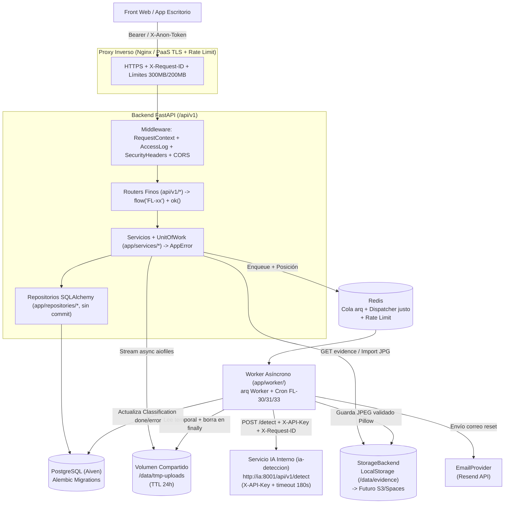

# 8. Plan de Remediación de Seguridad y Deuda Técnica

> [!NOTE]
> Documento anterior: [[07_Brechas_Arquitectura_y_Contratos]] | Siguiente: [[wwf-backend-standards]] · [[wwf-api-contracts]]

Este plan define el **saneamiento obligatorio (Fase 0)** antes de construir los nuevos flujos (`arq`, `classifications`, `imports`, `admin`) para eliminar brechas activas de seguridad y deuda heredada de la hackathon.

---

## 8.1 Rotación y Limpieza de Secretos (Prioridad Inmediata)

| Hallazgo Actual | Archivo y Línea | Acción Correctiva Exacta |
| :--- | :--- | :--- |
| Contraseña real de PostgreSQL Aiven (`AVNS_...`) en texto plano | `digitalocean.yaml` (L39) y `check_db.py` (L5) | **1.** Rotar de inmediato la contraseña del usuario `avnadmin` en la consola de Aiven Cloud. **2.** Reemplazar en `digitalocean.yaml` por referencia a variable de entorno (`${DATABASE_URL}`) y eliminar la cadena literal de `check_db.py` (leer `settings.DATABASE_URL`). **3.** Limpiar el historial de Git con `git filter-repo` (o BFG Repo-Cleaner) y activar `gitleaks` / `detect-secrets` en *pre-commit* (`ESTANDARES §10.3`). |
| API Key de VisualCrossing expuesta (`4CVBMAAYQ2HW86J7AARDANRDA`) | `app/services/species_data_service.py` (L180) | Revocar/rotar la clave y definir si el enriquecimiento climático sigue en el TDR; si se conserva, moverla a `Settings` y prohibir `os.environ` fuera de `app/core/config.py`. |
| Secretos JWT débiles por defecto (`"super-secret-key-..."`) | `app/core/config.py` (L16-17) | Eliminar los valores por defecto. Añadir `@model_validator` en `Settings` que valide `len(SECRET_KEY) >= 32` y `len(REFRESH_SECRET_KEY) >= 32` (y `SECRET_KEY != REFRESH_SECRET_KEY`), abortando el arranque con log `CRITICAL config.invalid` si fallan (`ESTANDARES §8`). |
| Orígenes `localhost` forzados en producción | `app/core/config.py` (L53-57) | Agregar `localhost:5173` / `3000` **únicamente** cuando `ENVIRONMENT == EnvironmentMode.DEVELOPMENT`. |
| Credencial hardcodeada de FFmpeg en Windows | `app/services/video_service.py` (L6-7) | Eliminar `FFMPEG_PATH` hardcodeado; usar `ffprobe` del `PATH` del sistema (ya instalado en `Dockerfile` L34) o una variable opcional en `Settings`. |

---

## 8.2 Cierre de Brechas de Acceso, Routers Legacy y BOLA/IDOR

### 1. Eliminación de Routers y Tablas Legacy Expuestas
De acuerdo con `API_BACK_FRONT.md` (§15, línea 1098), los siguientes routers abiertos sin autenticación **deben eliminarse** (o bloquearse tras migración de datos) porque rompen la seguridad y duplican el modelo de datos:
- `app/api/v1/videos.py` (montado en raíz `/` sin `prefix`, sin JWT, hard delete físico).
- `app/api/v1/ai_router.py` (público sin JWT y con schema roto `ai_raw_response`).
- `app/api/v1/species.py` (público sin JWT, hard delete, fallback climático aleatorio en `species_data_service.py`).
- `app/api/v1/individuals.py` (público sin JWT, fuera del alcance de contratos v1).
- `app/api/v1/reports.py` (público sin JWT, filtros atados a `CameraStation.project_id` legacy; reemplazado por `/camera-stations/{id}/stats`, `/projects/{id}/stats`, `/reports/excel` y `/reports/pdf`).
- `app/api/v1/media_files.py` (reemplazado por `/classification-batches/*` y `/classifications/*`).
- `app/api/v1/users.py` (reemplazado por `/auth/me` para el usuario propio y `/admin/users/*` para administración).

### 2. Corrección Inmediata de BOLA/IDOR y Privacidad (Mientras se Migra)
Si algún router v4 permanece temporalmente activo durante la transición:
1. **`app/api/v1/users.py` (L93-220):** Deshabilitar `GET /users/` y `GET /users/{user_id}` públicos. En `PATCH` y `DELETE /users/{user_id}`, exigir `user_id == current_user.id` o `current_user.role == "admin"`, e impedir que un usuario modifique su propio `is_active` o `role`.
2. **`app/services/project_service.py` (L208-293):** En `associate_station` y `disassociate_station`, exigir dueño (`get_owner`) y validar `project.owner == owner` **y** `station.owner == owner` (error `403 CAMERA_NOT_OWNED` / `FORBIDDEN`).
3. **Visibilidad y Coordenadas (DD-17):** Aplicar filtro estricto de visibilidad en todas las consultas (`WHERE visibility = 'public' OR owner_match`, devolviendo `404` si es privado ajeno para no filtrar existencia) y redondear `latitude`/`longitude` a 2 decimales cuando el consultante no sea el dueño.
4. **Ocultación de Errores Internos (`app/main.py` L95-100):** Reemplazar `str(exc)` por mensaje genérico `"Ocurrió un error inesperado."`, código `INTERNAL_ERROR` y `meta.request_id` (registrando el traceback únicamente en el log JSON estructurado).

### 3. Saneamiento de Base de Datos y Migraciones
1. Unificar `videos`, `media_files` y `species` en el modelo canónico `classifications` + `classification_batches` + `validation_history` + `desktop_imports` + `refresh_tokens` + `password_reset_tokens` + `system_settings` + `admin_audit_log`.
2. Corregir la PK compuesta de 3 columnas en `ProjectStation` (`app/models/project_station.py`), quitando `primary_key=True` de `project_id`/`station_id` (o quitando `BaseEntity.id`) y usando índice único `(project_id, station_id)` cuando `is_deleted = False`.
3. Generar la migración inicial real en `migrations/versions/` con Alembic (`alembic revision --autogenerate`) y retirar `lazy="selectin"` indiscriminado de las relaciones ORM (cargar relaciones explícitamente solo en los queries del repositorio que las necesiten).

---

## 8.3 Arquitectura Objetivo (Cumpliendo `ESTANDARES_BACKEND_IA.md`)

