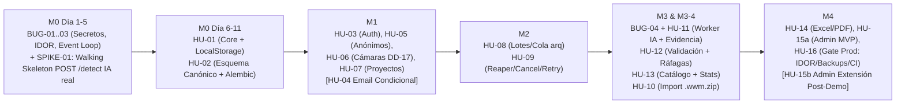

# 9. Matriz de Trazabilidad de Flujos (`FL-xx`) y Casos Borde (`CB-xx`)

> [!NOTE]
> Documento anterior: [[08_Plan_Remediacion_Seguridad_y_Deuda]] | DoD Único: [[DEFINITION_OF_DONE]] | Siguiente: [[10_Backlog_Teamwork_WWF]] | To-Do `/teamwork`: [[11_Teamwork_Todolist_WWF]]

Este documento cruza el 100 % de los flujos funcionales (`FL-01` a `FL-46` de `FLUJOS_SISTEMA.md`) y el 100 % de los casos borde (`CB-01` a `CB-99` de `CASOS_BORDE.md`) clasificándolos por **nivel de riesgo de prueba** para evitar sobre-ingeniería y maximizar código funcional por semana.

---

## 9.1 Trazabilidad Completa de Flujos (`FL-xx`)

| ID | Flujo Funcional | Prioridad | Endpoints / Contratos Involucrados | Estado Actual en `BACKWWF` | Ticket Asignado |
| :--- | :--- | :---: | :--- | :--- | :--- |
| **FL-01** | Registro de cuenta | P0 | `POST /api/v1/auth/register` (API §2.1) | **Parcial:** falta `/api/v1`, `X-Anon-Token`, `AUTH_WEAK_PASSWORD` y eliminar `sexo`. | `HU-03` |
| **FL-02** | Inicio/cierre de sesión y renovación JWT | P0 | `POST /auth/login`, `refresh`, `logout`, `GET/PATCH /auth/me`, `POST /auth/me/password` (API §2.2–2.7) | **Parcial:** faltan `logout`, `PATCH /me`, `me/password`, rotación/revocación y rate limit. | `HU-03` |
| **FL-03** | Inicio de sesión anónima | P0 | `POST /anon-sessions`, `GET /anon-sessions/current` (API §3.1–3.2) | **Parcial:** solo UUID en memoria; falta hash SHA-256, TTL 24h, límites y `anon_retain`. | `HU-05` |
| **FL-04** | Asociación de datos anónimos a cuenta | P0 | `POST /anon-sessions/claim`, `POST /anon-sessions/current/close` (API §3.3–3.4) | **Parcial:** falta `close`, renombrado `-2` y traspaso de `classifications`. | `HU-05` |
| **FL-05** | Registro de cámara con clic en el mapa | P0 | `POST /camera-stations`, `GET /camera-stations/nearby` (API §5.2, §5.7) | **Parcial:** faltan `nearby`, `version`, fechas futuras, `ANON_PUBLIC_NOT_ALLOWED`. | `HU-06` |
| **FL-06** | Edición, retiro, eliminación y desfase horario de cámara | P1 | `PATCH/DELETE /camera-stations/{id}`, `POST /camera-stations/{id}/time-offset` (API §5.4–5.5, §5.9) | **Parcial:** sin `If-Match`, sin dueño anónimo, sin cascada ni `time-offset`. | `HU-06` |
| **FL-07** | Creación de proyecto y asociación N:M de cámaras | P0 | `GET/POST /projects`, `GET/PATCH/DELETE /projects/{id}`, `POST/DELETE /projects/{id}/camera-stations` (API §6) | **Parcial:** nombres legacy y **BOLA** en asociación de estaciones. | `BUG-02`, `HU-07` |
| **FL-08** | Carga y clasificación de archivos | P0 | `POST /classification-batches`, `.../files`, `.../complete`, `GET .../evidence` + `API_IA_BACK.md` `POST /detect` | **Roto / Mock:** I/O síncrono bloqueante, `timeout=2.0` y **mock de Jaguar** en `ai_service.py`. | `BUG-03`, `BUG-04`, `SPIKE-01`, `HU-08`, `HU-11` |
| **FL-09** | Seguimiento de lote en segundo plano, cancelar y reintentar | P1 | `GET /classification-batches?active=true`, `GET .../{id}?since=`, `POST .../cancel`, `DELETE .../items/{i}`, `POST .../retry` | **No implementado.** | `HU-08`, `HU-09` |
| **FL-10** | Validación y corrección de clasificaciones | P0 | `PUT /classifications/{id}/validation`, `POST .../validation-batch`, `GET /catalog/species` | **Parcial:** solo `POST /species/{id}/verify` abierto sin auth. | `BUG-02`, `HU-12`, `HU-13` |
| **FL-11** | Consulta de estadísticas (cámara o proyecto) | P0 | `GET /camera-stations/{id}/stats`, `GET /projects/{id}/stats` (API §10) | **Parcial:** legacy sin auth atado a FK vieja y APIs externas clima/luna. | `BUG-02`, `HU-13` |
| **FL-12** | Exportación a Excel y PDF | P0 | `GET /reports/excel`, `GET /reports/pdf` (API §11) | **No implementado.** | `HU-14` |
| **FL-13** | Exploración del contenido público | P1 | `GET /camera-stations?scope=all&view=map`, `GET /projects?scope=public` | **Parcial:** no oculta privados ni redondea coordenadas (DD-17). | `HU-06`, `HU-07` |
| **FL-14** | Recuperación de contraseña por correo (Resend) | P1 / Condicional | `POST /auth/password/forgot`, `GET .../reset/validate`, `POST .../reset`, `POST /admin/users/{id}/password-reset-link` | **No implementado** (dependiente de dominio SPF/DKIM; respaldo manual en `HU-15a`). | `HU-04`, `HU-15a` |
| **FL-15** | Reinstalación de cámara en el mismo punto | P1 | `POST /camera-stations/{id}/redeploy` (API §5.8) | **No implementado.** | `HU-06` |
| **FL-16** | Revisión de ráfagas (registros repetidos) | P1 | `GET /classifications/burst-candidates`, `POST .../repeat-batch`, `POST .../dismiss` | **No implementado.** | `HU-12` |
| **FL-20** | Escritorio: primer inicio y descarga del modelo | P0 | Repo `ia-deteccion/desktop` (`APP_VERSION`) | **Fuera de `BACKWWF` (Escritorio):** validar compatibilidad en `HU-16`. | `HU-16` |
| **FL-21** | Escritorio: clasificación de carpeta | P0 | Repo `ia-deteccion/desktop` (`clasificaciones.jsonl`) | **Fuera de `BACKWWF` (Escritorio):** consumido por `HU-10` / validado en `HU-16`. | `HU-10`, `HU-16` |
| **FL-22** | Escritorio: exportación de paquete `.wwm.zip` | P1 | `PAQUETE_ESCRITORIO.md` (`manifest.json`, `classifications.jsonl`, `evidence/*.jpg`) | **Fuera de `BACKWWF` (Escritorio):** validado en `HU-10` / `HU-16`. | `HU-10`, `HU-16` |
| **FL-23** | Web: importación de paquete de escritorio | P1 | `POST /imports/desktop`, `POST /imports/{id}/confirm`, `DELETE /imports/{id}`, `GET /imports` | **No implementado.** | `HU-10` |
| **FL-30** | Cron: vencimiento de sesiones anónimas y purga condicional | P0 | Worker `arq` cron horario (`anon_sessions`, `anon_retain`, `anon_purge_runs`) | **No implementado.** | `HU-05` |
| **FL-31** | Cron: limpieza de temporales y fotogramas huérfanos | P1 | Worker `arq` cron horario y al arranque (`TMP_UPLOAD_PATH`, `LocalStorage`) | **No implementado.** | `HU-01`, `HU-09` |
| **FL-32** | Backup de base de datos y fotogramas | P0 | Scripts `pg_dump` + volumen `STORAGE_LOCAL_PATH` | **No implementado.** | `HU-16` |
| **FL-33** | Cron: *Reaper* de la cola Redis/`arq` | P0 | Worker `arq` cron cada 5 min (`heartbeat_at`, `attempts`, `PROCESSING_EXPIRED`) | **No implementado.** | `HU-09` |
| **FL-40** | Admin: panel de estadísticas globales y Excel | P1 | `GET /admin/stats` (`HU-15a`) y `GET /admin/reports/excel` (`HU-15b`) | **No implementado.** | `HU-15a`, `HU-15b` |
| **FL-41** | Admin: exploración de datos anónimos y públicos | P1 | `GET /admin/camera-stations`, `/classifications`, `/evidence`, `/anon-sessions` | **No implementado.** | `HU-15a` |
| **FL-42** | Admin: borrado lógico en cascada y restauración | P1 | `POST /admin/{entity}/{id}/delete`, `restore`, `delete-batch` | **No implementado.** | `HU-15a` |
| **FL-43** | Admin: gestión de usuarios (desactivar/reactivar) | P1 | `GET /admin/users`, `POST .../deactivate`, `reactivate` | **Incompleto y vulnerable:** `users.py` expone CRUD sin rol `admin`. | `BUG-02`, `HU-15a` |
| **FL-44** | Admin: configuración de retención de datos anónimos | P1 | `GET/PUT /admin/settings` (`anon_data_retention`) | **No implementado.** | `HU-15a` |
| **FL-45** | Admin: monitor de cola y cuota de correos | P2 | `GET /admin/queue` | **No implementado (extensión post-demo).** | `HU-15b` |
| **FL-46** | Admin: desempeño del modelo y sugerencias no catalogadas | P2 | `GET /admin/stats` (`model_feedback` en `HU-15a`), `GET /admin/unlisted-suggestions` (`HU-15b`) | **No implementado.** | `HU-15a`, `HU-15b` |

---

## 9.2 Cobertura y Clasificación por Riesgo de Casos Borde (`CB-01` a `CB-99`)

**Criterio de pruebas (`DEFINITION_OF_DONE.md`):**
* 🔴 **Automatizar siempre (bloquea merge):** Seguridad, privacidad (IDOR, DD-17) e integridad de datos.
* 🟡 **Test parametrizado por grupo:** Casos similares agrupados con `@pytest.mark.parametrize`.
* 🟢 **Verificación manual con nota en PR:** Comportamiento cosmético o de baja probabilidad (`verificado a mano: ver CB-xx`).

### Grupo 1: Ubicación de Cámaras Trampa (`CB-01` – `CB-10`)
| ID | Escenario | Endpoint / Componente | Respuesta HTTP y Código | Nivel de Prueba | Ticket |
| :---: | :--- | :--- | :--- | :--- | :---: |
| **CB-01** | Cámara cercana propia instalada (< 30 m) | `GET /camera-stations/nearby` | `200` `mine[]` (`still_installed=true`) | 🟡 Parametrizado grupo `nearby` | `HU-06` |
| **CB-02** | Cámara cercana propia retirada (< 30 m) | `GET /camera-stations/nearby` | `200` `mine[]` (`still_installed=false`) | 🟡 Parametrizado grupo `nearby` | `HU-06` |
| **CB-03** | Reinstalación en el mismo punto | `POST /camera-stations/{id}/redeploy` | `201` `{camera_station, previous}` | 🟡 Test grupo `redeploy` | `HU-06` |
| **CB-04** | Cámara pública ajena cercana | `GET /camera-stations/nearby` | `200` `public_others[]` con `distance_band` | 🔴 Automatizar siempre (privacidad) | `HU-06` |
| **CB-05** | Cámara privada ajena cercana | `GET /camera-stations/nearby` | `200` omite totalmente la privada ajena | 🔴 Automatizar siempre (privacidad) | `HU-06` |
| **CB-05b** | Triangular ubicación pública ajena | `camera-stations*`, `nearby`, `stats`, `reports` | `200` coords a 2 decimales (`approx_1km`) | 🔴 Automatizar siempre (DD-17) | `HU-06` |
| **CB-06** | Coordenadas < 1 m y fechas superpuestas | `GET /camera-stations/nearby` | `200` `same_location=true`, `overlapping_period=true` | 🟡 Parametrizado grupo `nearby` | `HU-06` |
| **CB-07** | Coordenadas `0,0` o invertidas vs `REGION_BBOX` | `POST/PATCH /camera-stations` | `201/200` `warning: CAMERA_COORDS_SUSPECT` | 🟢 Manual con nota en PR | `HU-06` |
| **CB-08** | Lat/lng fuera de rango | `POST/PATCH /camera-stations` | `422 VALIDATION_ERROR` | 🟡 Parametrizado validación cámara | `HU-06` |
| **CB-09** | Mover > 50 m cámara con clasificaciones | `PATCH /camera-stations/{id}` | `200` `warning: CAMERA_MOVED_WITH_DATA` | 🟢 Manual con nota en PR | `HU-06` |
| **CB-10** | Marcadores superpuestos en mapa | `GET /camera-stations?view=map` | `200` lista individual sin colapsar | 🟢 Manual con nota en PR | `HU-06` |

### Grupo 2: Datos y Fechas de la Cámara (`CB-11` – `CB-21`)
| ID | Escenario | Endpoint / Componente | Respuesta HTTP y Código | Nivel de Prueba | Ticket |
| :---: | :--- | :--- | :--- | :--- | :---: |
| **CB-11** | `retrieved_at < deployed_at` | `POST/PATCH /camera-stations` | `422 CAMERA_INVALID_DATES` | 🟡 Parametrizado validación cámara | `HU-06` |
| **CB-12** | Fechas futuras (> 1 día) | `POST/PATCH /camera-stations` | `422 CAMERA_INVALID_DATES` | 🟡 Parametrizado validación cámara | `HU-06` |
| **CB-13** | Código repetido por dueño (case-insensitive) | `POST/PATCH /camera-stations` | `409 CAMERA_CODE_TAKEN` | 🔴 Automatizar siempre (integridad) | `HU-06` |
| **CB-14** | Concurrencia creando mismo código | `POST /camera-stations` | `409 CAMERA_CODE_TAKEN` | 🔴 Automatizar siempre (integridad) | `HU-06` |
| **CB-15** | Edición concurrente (`If-Match != version`) | `PATCH /camera-stations/{id}`, `/projects/{id}` | `409 CONFLICT_STALE` | 🔴 Automatizar siempre (integridad) | `HU-06`, `HU-07` |
| **CB-16** | Subir archivos a cámara retirada | `POST /classification-batches` y `/files` | `201` / `202` | 🟢 Manual con nota en PR | `HU-08` |
| **CB-17** | `captured_at` fuera de despliegue | Worker + `POST /imports/desktop` | `warning: CAPTURE_OUTSIDE_DEPLOYMENT` | 🟡 Parametrizado grupo clasificación/import | `HU-10`, `HU-11` |
| **CB-18** | Corregir desfase de reloj | `POST /camera-stations/{id}/time-offset` | `200` `{updated}` (preserva original) | 🟡 Test dedicado `time-offset` | `HU-06` |
| **CB-19** | Cambiar fechas con clasificaciones previas | `PATCH /camera-stations/{id}` + `/stats` | `200`; recalcula `trap_days` | 🟢 Manual con nota en PR | `HU-06`, `HU-13` |
| **CB-20** | Pasar cámara pública a privada en proyecto público | `PATCH /camera-stations/{id}` + `/projects/{id}/stats` | `200`; excluye datos de terceros | 🔴 Automatizar siempre (privacidad) | `HU-06`, `HU-07` |
| **CB-20b** | Hacer pública cámara/proyecto (anónimo bloqueado) | `PATCH /camera-stations/{id}`, `/projects/{id}` | `422 ANON_PUBLIC_NOT_ALLOWED` (anónimo) | 🔴 Automatizar siempre (seguridad) | `HU-06`, `HU-07` |
| **CB-21** | Eliminar cámara en proyectos con ítems en cola | `DELETE /camera-stations/{id}` + Worker | `204`; borrado cascada + cancela `queued` | 🟡 Test grupo cascada/cola | `HU-06`, `HU-09` |

### Grupo 3: Proyectos (`CB-22` – `CB-27`)
| ID | Escenario | Endpoint / Componente | Respuesta HTTP y Código | Nivel de Prueba | Ticket |
| :---: | :--- | :--- | :--- | :--- | :---: |
| **CB-22** | Proyecto público sin cámaras públicas | `GET /projects/{id}` y `/stats` | `200` `camera_stations: []` | 🟢 Manual con nota en PR | `HU-07` |
| **CB-23** | Asociar cámara ajena (aunque sea pública) | `POST /projects`, `POST /projects/{id}/camera-stations` | `403 CAMERA_NOT_OWNED` | 🔴 Automatizar siempre (IDOR/BOLA) | `BUG-02`, `HU-07` |
| **CB-24** | Asociar cámara ya asociada | `POST /projects/{id}/camera-stations` | `409 ALREADY_ASSOCIATED` | 🟡 Test grupo asociación N:M | `HU-07` |
| **CB-25** | Dos proyectos con mismo nombre | `POST /projects` | `201` permitido | 🟢 Manual con nota en PR | `HU-07` |
| **CB-26** | Cámara en varios proyectos | `POST /projects/{id}/camera-stations` + `/stats` | `200` | 🟢 Manual con nota en PR | `HU-07` |
| **CB-27** | Eliminar proyecto conserva cámaras | `DELETE /projects/{id}` | `204` | 🟡 Test grupo eliminación proyecto | `HU-07` |

### Grupo 4: Subida y Cola de Procesamiento (`CB-30` – `CB-44`)
| ID | Escenario | Endpoint / Componente | Respuesta HTTP y Código | Nivel de Prueba | Ticket |
| :---: | :--- | :--- | :--- | :--- | :---: |
| **CB-30** | Cola justa (`QUEUE_PER_OWNER_INFLIGHT=2`) | `app/worker/dispatcher.py` | `202` + round-robin por dueño | 🟡 Parametrizado grupo cola/dispatcher | `HU-08` |
| **CB-31** | Navegación durante subida (`?active=true`) | `GET /classification-batches?active=true` | `200` | 🟡 Parametrizado grupo lotes | `HU-08` |
| **CB-32** | Cierra pestaña subiendo (cierre por inactividad 60m) | Cron inactividad | Lote pasa a `incomplete` | 🟡 Parametrizado grupo reaper/cron | `HU-08`, `HU-09` |
| **CB-33** | Cierra pestaña con ítems ya en cola | Worker `classify_file_job` | Continúa en servidor | 🟡 Parametrizado grupo worker | `HU-08` |
| **CB-34** | Excede tope pendientes (`500` / `50` anónimo) | `POST /classification-batches`, `/files` | `429 QUEUE_USER_LIMIT` / `422 ANON_LIMIT_REACHED` | 🟡 Parametrizado límites cola | `HU-08` |
| **CB-35** | Cola global llena o disco ≥ 85 % | `POST /classification-batches/{id}/files` | `503 QUEUE_FULL` | 🟡 Parametrizado límites cola | `HU-08` |
| **CB-36** | Redis caído en subida | `POST /classification-batches/{id}/files` | `503 QUEUE_UNAVAILABLE` (lecturas `200`) | 🟡 Parametrizado límites cola | `HU-08` |
| **CB-37** | IA caída, lenta u ocupada (`IA_BUSY`) | Worker + `POST .../retry` | 2 reintentos (5s, 30s) -> `error` sin mock | 🔴 Automatizar siempre (DD-4 no mock) | `BUG-04`, `SPIKE-01`, `HU-09`, `HU-11` |
| **CB-38** | Reinicio worker a mitad de análisis | Cron *Reaper* `FL-33` | Re-encola `processing` sin heartbeat > 10m | 🟡 Parametrizado grupo reaper/cron | `HU-09`, `HU-11` |
| **CB-39** | Archivo en cola > 24h | Cron *Reaper* + `retry` | `PROCESSING_EXPIRED` + `410 RETRY_FILE_UNAVAILABLE` | 🟡 Parametrizado grupo reaper/cron | `HU-09` |
| **CB-40** | Cancelar lote o ítem | `DELETE .../items/{i}`, `POST .../cancel` | `queued`->`cancelled`, `processing`->`409` | 🟡 Parametrizado control de lote | `HU-09` |
| **CB-41** | Claim de sesión anónima con ítems en cola | `POST /anon-sessions/claim` + Worker | Worker lee dueño del lote al escribir `done` | 🟡 Parametrizado flujo anónimo/cola | `HU-05`, `HU-08` |
| **CB-42** | Sesión anónima vence con ítems en cola | Worker + Cron `FL-30` | Usa `anon_retain` fijado al subir | 🟡 Parametrizado retención anónima | `HU-05`, `HU-08` |
| **CB-43** | Admin cambia retención con ítems en cola | `PUT /admin/settings` + Worker | Solo afecta filas nuevas | 🟡 Parametrizado retención anónima | `HU-08`, `HU-15a` |
| **CB-44** | Admin desactiva usuario con ítems en cola | `POST /admin/users/{id}/deactivate` | Cancela `queued` (`ACCOUNT_DISABLED`) | 🔴 Automatizar siempre (seguridad) | `HU-08`, `HU-15a` |

### Grupo 5: Archivos, Duplicados y Ráfagas (`CB-50` – `CB-60d`)
| ID | Escenario | Endpoint / Componente | Respuesta HTTP y Código | Nivel de Prueba | Ticket |
| :---: | :--- | :--- | :--- | :--- | :---: |
| **CB-50** | Mismo SHA-256 en misma cámara | `POST /classification-batches/{id}/files` | `200` `DUPLICATE_FILE` (no encola) | 🔴 Automatizar siempre (integridad) | `HU-08` |
| **CB-51** | Mismo SHA-256 en otra cámara propia | `POST .../files` + `PATCH /classifications/{id}` | `200` `DUPLICATE_FILE_OTHER_CAMERA` | 🔴 Automatizar siempre (integridad) | `HU-08`, `HU-12` |
| **CB-52** | Mismo SHA-256 en dos usuarios distintos | `POST .../files` + `GET /admin/stats` | `202` cada uno; dedup en `admin/stats` | 🔴 Automatizar siempre (aislamiento) | `HU-08`, `HU-15a` |
| **CB-53** | Mismo nombre con distinto contenido | `POST .../files` | `202` `queued` | 🟢 Manual con nota en PR | `HU-08` |
| **CB-54** | Contenido igual con archivo renombrado | `POST .../files` | `DUPLICATE_FILE` por SHA-256 | 🔴 Automatizar siempre (integridad) | `HU-08` |
| **CB-55** | Mismo archivo por Web y por Escritorio | `POST /imports/desktop` y `confirm` | Contado en `duplicates` y omitido | 🔴 Automatizar siempre (integridad) | `HU-10` |
| **CB-56** | Video 15.3 s vs 15.6 s | `POST .../files` (`ffprobe`) | 15.3 s -> `202`; 15.6 s -> `MEDIA_DURATION_EXCEEDED` | 🟡 Parametrizado validación media | `HU-08` |
| **CB-57** | Extensión `.mp4` con firma binaria falsa | `POST .../files` (`python-magic`) | `200` `MEDIA_UNSUPPORTED_FORMAT` | 🟡 Parametrizado validación media | `HU-08` |
| **CB-57b** | Formatos AVI/MKV/MTS/HEIC | `POST .../files` (`ffprobe`) | `202` `queued` | 🟡 Parametrizado validación media | `HU-08` |
| **CB-57c** | Extensión fuera de lista (`.raw`, `.exe`) | `POST .../files` | `200` `MEDIA_UNSUPPORTED_FORMAT` | 🟡 Parametrizado validación media | `HU-08` |
| **CB-58** | Archivo corrupto o truncado | `ffprobe` / Worker (`IA_DECODE_FAILED`) | `MEDIA_DECODE_FAILED` | 🟡 Parametrizado validación media | `HU-08`, `HU-11` |
| **CB-59** | Imagen > 100 MP / decompression bomb | `POST .../files` (Pillow) | `200` `MEDIA_TOO_LARGE` | 🟡 Parametrizado validación media | `HU-08` |
| **CB-60** | Ráfaga: 3 fotos mismo animal < 5 min | `burst-candidates`, `repeat-batch` | Agrupa 3; `discarded_repeat` excluidos | 🟡 Parametrizado grupo ráfagas | `HU-12` |
| **CB-60b** | Especies distintas en 1 min | `GET /classifications/burst-candidates` | No agrupa especies distintas | 🟡 Parametrizado grupo ráfagas | `HU-12` |
| **CB-60c** | Capturas con `upload_time` | `GET /classifications/burst-candidates` | Excluidas de sugerencias | 🟡 Parametrizado grupo ráfagas | `HU-12` |
| **CB-60d** | `keep_ids=[]` en `repeat-batch` | `POST /classifications/repeat-batch` | `422 REPEAT_KEEP_REQUIRED` | 🟡 Parametrizado grupo ráfagas | `HU-12` |

### Grupo 6: Clasificación y Validación (`CB-61` – `CB-68`)
| ID | Escenario | Endpoint / Componente | Respuesta HTTP y Código | Nivel de Prueba | Ticket |
| :---: | :--- | :--- | :--- | :--- | :---: |
| **CB-61** | IA solo llega a género o familia | Worker + `GET .../stats` | Cuenta en `by_genus`/`unidentified_to_species` | 🟡 Parametrizado grupo validación/stats | `HU-11`, `HU-13` |
| **CB-62** | `blank` corregido a `animal` | `PUT /classifications/{id}/validation` | `200`; `category="animal"` | 🟡 Parametrizado grupo validación | `HU-12` |
| **CB-63** | Falso positivo marcado `rejected` | `PUT /classifications/{id}/validation` | `200`; excluido de avistamientos | 🟡 Parametrizado grupo validación | `HU-12` |
| **CB-64** | Corrección desde catálogo | `PUT /classifications/{id}/validation` | `200`; `correction_source="catalog"` | 🟡 Parametrizado grupo validación | `HU-12` |
| **CB-65** | Especie no está en catálogo (`correct_unlisted`) | `PUT .../validation` + `unlisted-suggestions` | `200`; guarda `suggested_name` | 🟡 Parametrizado grupo validación | `HU-12`, `HU-13`, `HU-15b` |
| **CB-66** | Historial de múltiples cambios en validación | `PUT /classifications/{id}/validation` | `200`; append en `validation_history` | 🟡 Parametrizado grupo validación | `HU-12` |
| **CB-67** | Lote con IDs ajenos o borrados | `POST /classifications/validation-batch` | `200` omite en `skipped[]` | 🔴 Automatizar siempre (IDOR) | `HU-12` |
| **CB-68** | Cambio futuro versión catálogo | `GET /classifications`, `/stats` | Conserva taxonomía histórica | 🟡 Parametrizado grupo catálogo | `HU-13` |

### Grupo 7: Sesión Anónima, Cuentas y Recuperación (`CB-70` – `CB-78`)
| ID | Escenario | Endpoint / Componente | Respuesta HTTP y Código | Nivel de Prueba | Ticket |
| :---: | :--- | :--- | :--- | :--- | :---: |
| **CB-70** | Dos pestañas sin cuenta | `POST /anon-sessions` | Tokens independientes | 🟢 Manual con nota en PR | `HU-05` |
| **CB-71** | Login en pestaña B con datos en A | `POST /anon-sessions/claim` | Solo asocia el `X-Anon-Token` enviado | 🟢 Manual con nota en PR | `HU-05` |
| **CB-72** | Registro con correo existente | `POST /auth/register` | `409 AUTH_EMAIL_TAKEN` | 🔴 Automatizar siempre (auth/integridad) | `HU-03` |
| **CB-73** | Recuperar contraseña de correo inexistente | `POST /auth/password/forgot` | `200` genérico sin enviar correo | 🔴 Automatizar siempre (privacidad/enum) | `HU-04` |
| **CB-74** | Múltiples solicitudes de reset seguidas | `POST /auth/password/forgot` | Invalida tokens previos; rate limit | 🔴 Automatizar siempre (seguridad) | `HU-04` |
| **CB-75** | Token reset vencido (> 30m) o reusado | `GET .../validate`, `POST .../reset` | `valid=false` / `400 AUTH_RESET_TOKEN_INVALID` | 🔴 Automatizar siempre (seguridad) | `HU-04` |
| **CB-76** | Cuota diaria/mensual Resend agotada | `POST /auth/password/forgot` | `503 EMAIL_TEMPORARILY_UNAVAILABLE` | 🟡 Test grupo email quota | `HU-04` |
| **CB-77** | Cuenta desactivada pide reset | `POST /auth/password/forgot` | `200` genérico, no envía correo | 🟡 Test grupo email | `HU-04` |
| **CB-78** | Cambio de contraseña revoca refresh tokens | `POST /auth/me/password`, `/reset` | Revoca otros `refresh_tokens` | 🔴 Automatizar siempre (seguridad) | `HU-03`, `HU-04` |

### Grupo 8 y 9: Importación Escritorio y Compatibilidad (`CB-80` – `CB-95`)
| ID | Escenario | Endpoint / Componente | Respuesta HTTP y Código | Nivel de Prueba | Ticket |
| :---: | :--- | :--- | :--- | :--- | :---: |
| **CB-80** | Paquete `CAM01` importado en `CAM02` | `POST /imports/desktop` | `201` `camera_code_matches=false` | 🟡 Parametrizado grupo importación | `HU-10` |
| **CB-81** | Paquete mezcla cámaras (fechas fuera rango) | `POST /imports/desktop` | `201` `CAPTURE_OUTSIDE_DEPLOYMENT` | 🟡 Parametrizado grupo importación | `HU-10` |
| **CB-82** | Reimportar mismo `package_sha256` | `POST /imports/desktop` | `409 IMPORT_ALREADY_IMPORTED` | 🔴 Automatizar siempre (integridad) | `HU-10` |
| **CB-83** | Paquetes distintos con archivos repetidos | `POST /imports/desktop` | `201` cuenta en `duplicates` | 🟡 Parametrizado grupo importación | `HU-10` |
| **CB-84** | `format_version` incompatible (`2.0`) | `POST /imports/desktop` | `422 IMPORT_UNSUPPORTED_VERSION` | 🟡 Parametrizado grupo importación | `HU-10` |
| **CB-85** | Confirmación paquete grande (miles de líneas) | `POST /imports/{id}/confirm` + Worker | Procesamiento en cola no bloqueante | 🟡 Test grupo importación/worker | `HU-10` |
| **CB-86** | Cámara en paquete sin coordenadas (`create_camera=true`) | `POST /imports/desktop` + `confirm` | `complete=false` -> exige `camera` en confirm | 🟡 Parametrizado grupo importación | `HU-10` |
| **CB-87** | Código de cámara en paquete ya existe en cuenta | `POST /imports/desktop` | `201` sugiere `matching_camera_station_id` | 🟡 Parametrizado grupo importación | `HU-10` |
| **CB-90, CB-91, CB-92, CB-93, CB-94, CB-95** | Reglas locales escritorio (destino=origen CB-90, sufijo CB-91, disco CB-92, apagón CB-93, bloqueado CB-94, rutas largas UTF-8 CB-95) | Contrato `PAQUETE_ESCRITORIO.md` (`package_contract.py`) | Back acepta UTF-8 largo (`CB-95`) y valida `source_folder_name` limpio en `manifest.json` | 🟢 Manual en app escritorio + test contrato UTF-8 en `HU-16` | `HU-16` |

### Grupo 10: Administración (`CB-96` – `CB-99`)
| ID | Escenario | Endpoint / Componente | Respuesta HTTP y Código | Nivel de Prueba | Ticket |
| :---: | :--- | :--- | :--- | :--- | :---: |
| **CB-96** | Admin pide recurso privado por ID | Todos `/admin/*` (`AdminScope`) | `404` | 🔴 Automatizar siempre (privacidad) | `HU-15a` |
| **CB-97** | Admin borra sesión anónima con ítems en cola | `POST /admin/anon-sessions/{id}/delete` | `200`; `queued` -> `cancelled` | 🔴 Automatizar siempre (integridad) | `HU-15a` |
| **CB-98** | Admin intenta desactivarse a sí mismo | `POST /admin/users/{id}/deactivate` | `409 CANNOT_DEACTIVATE_SELF` | 🔴 Automatizar siempre (seguridad) | `HU-15a` |
| **CB-99** | Pérdida de acceso al único admin | CLI `python -m app.cli reset-admin-password` | Actualiza `password_hash` y revoca tokens | 🔴 Automatizar siempre (recuperación) | `HU-15a` |

---

## 9.3 Flujo de Ejecución Ajustado (Walking Skeleton al Inicio de M0)

