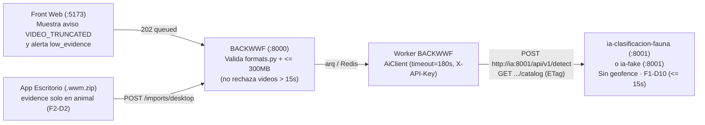

# 13. Diagnóstico de Congruencia: `ia-clasificacion-fauna` vs Contratos y Backlog (`BACKWWF`)

> [!NOTE]
> **Decisión aplicada (Instancia A):** Documentación normativa (`tareas-job/`), backlog (`10`, `11`), skills (`.agents/skills/wwf-*`) y espejos ya alineados contra `../ia-clasificacion-fauna`.
> Documentos contrastados: `../ia-clasificacion-fauna/` (código, `README.md`, `fake/README.md`, `tests/fixtures/README.md`, `eval/README.md`, `wwm_pipeline/*.py`, `api/*.py`, `deploy/docker-compose.example.yml`) frente a `tareas-job/` (`API_IA_BACK.md`, `API_BACK_FRONT.md`, `PAQUETE_ESCRITORIO.md`, `ESTANDARES_BACKEND_IA.md`, `FLUJOS_SISTEMA.md`, `CASOS_BORDE.md`, `TAREAS_BACKEND.md`, `PLAN_IMPLEMENTACION_TDR.md`) y el backlog en [[10_Backlog_Teamwork_WWF]] · [[11_Teamwork_Todolist_WWF]].

---

## 1. Situación Actual (Las tres realidades que hoy chocan)

Hoy conviven **tres versiones distintas** de cómo se comunican el Backend (`BACKWWF`) y la IA (`ia-clasificacion-fauna`), y esa desalineación explica las incongruencias detectadas:

1. **Lo que hoy corre en el código de `BACKWWF` (MVP Hackathon v4):**
   - `app/services/ai_service.py` llama a `{AI_SERVICE_URL}/api/v1/detect` enviando únicamente `files={"file": ...}` (sin `file_name` en formulario, sin `X-API-Key`, sin `X-Request-ID`), con `timeout=2.0`, esperando una estructura antigua `{results: [{detections: [...]}]}` y fabricando detecciones falsas de *Panthera onca* (`0.945`) cuando la IA tarda más de 2 segundos o no responde.
   - En el entorno Docker local sigue levantado el contenedor previo `wwf-wildlife-api` (`wwf-wildlife-detection:latest`) en el puerto **`8081`**.
2. **Lo que la documentación normativa (`tareas-job/`) y el backlog (`10_Backlog_Teamwork_WWF.md`) asumían que la IA haría:**
   - Se redactaron antes de que Diego cerrara la nueva versión del servicio de IA. Por ejemplo, exigían rechazar videos de más de 15 s, incluir el campo `geofence: "BOL"`, exigir fotogramas para personas/vehículos en paquetes `.wwm.zip`, esperar 2498 especies en el catálogo y validar formatos `DD-18` (como `HEIC` o `MTS`) desde el inicio.
3. **Lo que realmente implementa hoy el repositorio hermano `../ia-clasificacion-fauna`:**
   - Diego ya implementó y probó el nuevo *pipeline* (`wwm_pipeline/`), la API (`api/`), la IA simulada (`fake/`), el catálogo exportado (`catalog/speciesnet_catalog.json`), los esquemas JSON (`schemas/`) y los *fixtures* (`tests/fixtures/`). En ese desarrollo se tomaron decisiones técnicas explícitas (identificadas en su código como `F1-D10`, `F2-D2`, `F2-D9`, `E2-D5`, `HU-IA-*`) que **no se reflejaron de vuelta en `tareas-job/` ni en `BACKWWF`**.

---

## 2. Comparativa Detallada por Punto (Lo Esperado en `tareas-job/` y `HU-xx` vs Lo Encontrado en `ia-clasificacion-fauna`)

### Punto 1 · Videos mayores a 15 segundos: Rechazo (`422`) vs Truncado Automático (`F1-D10`)

- **Dónde estaba establecido:** `BE-21`, `BE-13`, `CB-56`, `FL-08`, `API_IA_BACK.md §2.5`, `API_BACK_FRONT.md §1.9 y §7.2`, `ESTANDARES_BACKEND_IA.md §6.1–§6.2`, `TAREAS_BACKEND.md` (L358, L372), y en el backlog actual en **`HU-08`** (`CA-2`, `CA-3`) y **`HU-11`**.
- **Qué se esperaba:** En **`HU-08`** (`BE-21` / `BE-13` / `CB-56`) se esperaba que el backend inspeccionara la duración con `ffprobe` al momento de subir el archivo; un video de `15.3 s` pasaba con `202` por la tolerancia de `+0.5 s`, pero uno de `15.6 s` o `16 s` debía ser **rechazado inmediatamente** con `item.status="error"` y código `MEDIA_DURATION_EXCEEDED` (`422`), sin encolarlo en Redis. Además, si llegaba a la IA, se esperaba que `POST /detect` respondiera `422 IA_DURATION_EXCEEDED` como defensa en profundidad.
- **Qué se encontró en `../ia-clasificacion-fauna`:**
  - Por la decisión **`F1-D10`** (documentada en `wwm_pipeline/contract.py` L170, `wwm_pipeline/sampling.py` L14–15, `fake/scenarios.py` L39–40 y `tests/fixtures/README.md` L21, L23), **la IA ya no rechaza ningún video por duración**.
  - `error_duration.json` fue **eliminado** de los fixtures. Si entra un video de, por ejemplo, `46.6 s` (dentro del límite de peso `MAX_FILE_MB = 300`), la IA analiza **únicamente los primeros `15 s`**, responde **`200 OK`** con la clasificación obtenida en ese tramo e incluye `analysis.truncated_at_seconds = 15.0`.
  - Según `tests/fixtures/README.md` (L21), la expectativa desde el equipo de IA es que el backend no lo rechace, sino que lo informe al usuario como un aviso **`VIDEO_TRUNCATED`**.
- **Impacto si no se resuelve:** Si `HU-08` se programa siguiendo el texto actual de `tareas-job/`, el backend bloqueará con error `422` todos los videos > 15.5 s antes de que lleguen a la IA, anulando una mejora ya construida por Diego y obligando al usuario a recortar videos manualmente en campo.

---

### Punto 2 · Eliminación del campo `geofence` y validación estricta del contrato (`extra="forbid"`)

- **Dónde estaba establecido:** `IA-12`, `IA-18`, `BE-04`, `API_IA_BACK.md §2.2, §3 y §5`, `API_BACK_FRONT.md §1.8 y §12.1`, `PAQUETE_ESCRITORIO.md §2`, `FLUJOS_SISTEMA.md §3` (L118), `ESTANDARES_BACKEND_IA.md §2.2`, `PLAN_IMPLEMENTACION_TDR.md` (L115, L121), y en nuestro backlog en **`HU-02`** (columna `classifications.geofence`), **`SPIKE-01`**, **`HU-10`**, **`HU-11`** y **`HU-16`**.
- **Qué se esperaba:** En **`HU-02`** (`BE-04`), **`SPIKE-01`** y **`HU-11`** se esperaba que el objeto `data.model` devuelto por `POST /detect`, el endpoint `GET /health` de la IA y el `manifest.json` de escritorio incluyeran `"geofence": "BOL"`, porque SpeciesNet filtraría especies imposibles para Bolivia; y se esperaba guardar ese valor en la columna `classifications.geofence`.
- **Qué se encontró en `../ia-clasificacion-fauna`:**
  - En `wwm_pipeline/classification.py` (L5) se documenta explícitamente: *"Sin filtro geográfico: se usa todo el catálogo."*
  - En `wwm_pipeline/contract.py` (L33, L183–188), `ModelInfo` hereda de `_Strict` (`ConfigDict(extra="forbid")`) y tiene **únicamente 4 campos**: `detector`, `classifier`, `sampling` y `pipeline_version`. El campo `geofence` **fue eliminado** tanto de `POST /detect` como de `GET /health` (`config`) y de `manifest.json` (`tools/make_sample_packages.py` L30–35).
- **Impacto si no se resuelve:** Si **`SPIKE-01`** o **`HU-11`** implementan el schema antiguo esperando `model.geofence`, la validación Pydantic fallará con error de campo faltante (`AI_BAD_RESPONSE` en cada archivo), o viceversa: si `ia-clasificacion-fauna` validara un payload con `geofence`, `extra="forbid"` lo rechazaría. Además `HU-02` crearía una columna `geofence` en PostgreSQL que siempre quedaría vacía o con un valor inventado.

---

### Punto 3 · Nuevos campos en `Analysis` (`truncated_at_seconds`, `low_evidence`, `"cap"`) y nuevo formato de `model.sampling`

- **Dónde estaba establecido:** `IA-11`, `IA-13`, `BE-03`, `BE-04`, `API_IA_BACK.md §2.2–§2.3`, `PAQUETE_ESCRITORIO.md §2`, y en nuestro backlog en **`SPIKE-01`**, **`HU-02`**, **`HU-11`** y **`HU-12`**.
- **Qué se esperaba:** En **`SPIKE-01`** y **`HU-11`** se esperaba `frames_discarded: {"duplicate": ..., "blurry": ...}` y `model.sampling` con cadenas cortas como `"4fps+first10"` (web) o `"6fps+first10"` (escritorio). No existían campos para detectar evidencia débil ni truncamiento de video.
- **Qué se encontró en `../ia-clasificacion-fauna`:**
  - En `wwm_pipeline/contract.py` (L165–175) y `wwm_pipeline/response.py` (L66–77), el bloque `analysis` ahora contiene:
    - `frames_discarded` con **3 claves fijas**: `{"duplicate": int, "blurry": int, "cap": int}` (los frames descartados por el tope máximo `max_frames`).
    - `truncated_at_seconds: float | None` (`15.0` cuando se recortó el análisis a 15 s).
    - `low_evidence: bool` (`HU-IA-13`: `true` cuando el animal apareció en un solo frame con peso bajo `< 0.25`, para que la interfaz de usuario pida revisión humana).
  - En `wwm_pipeline/config.py` (L91–127) y `sampling.py` (L64–69), `model.sampling` genera etiquetas descriptivas completas:
    - Web: `"10fps@0-2s+4fps/max60/hasta15s"` (o `"image"` para fotos).
    - Escritorio: `"15fps@0-2s+6fps/max120"`.
- **Impacto si no se resuelve:** Si `HU-02` y `HU-11` no guardan `low_evidence` (o no mapean `truncated_at_seconds` a `VIDEO_TRUNCATED`), el frontend nunca sabrá cuándo mostrar al biólogo la alerta de *"baja evidencia, revisar manualmente"* ni por qué un video de 45 s solo mostró resultados de los primeros 15 s.

---

### Punto 4 · Paquete de Escritorio (`.wwm.zip`): Privacidad en `person`/`vehicle` y códigos de validación

- **Dónde estaba establecido:** `BE-40`, `FL-22`, `FL-23`, `PAQUETE_ESCRITORIO.md §3` (L83) y `§5` (L97–108), y en nuestro backlog en **`HU-10`** y **`HU-16`**.
- **Qué se esperaba:** En **`HU-10`** (importación de paquetes `.wwm.zip`), siguiendo `PAQUETE_ESCRITORIO.md` L83, se esperaba que toda línea con `category ∈ {animal, person, vehicle}` trajera obligatoriamente un objeto `evidence` con su archivo `evidence/<sha256>.jpg` dentro del ZIP.
- **Qué se encontró en `../ia-clasificacion-fauna`:**
  - Por las decisiones de privacidad **`F2-D2` y `F2-D9`** (`wwm_pipeline/package.py` L28–30, L212–216 y `tools/make_sample_packages.py` L118–119), **la app de escritorio solo guarda y exporta fotogramas de fauna (`CATEGORIES_WITH_EVIDENCE_IN_PACKAGE = {animal}`)**.
  - Las líneas de **`person`** y **`vehicle`** en `classifications.jsonl` viajan con **`evidence: null`** y sin archivo JPG en `evidence/` (en `POST /detect` de la web sí sigue viniendo `evidence` para `person` y `vehicle`, la diferencia es exclusiva del paquete de escritorio).
  - Además, `wwm_pipeline/package_validator.py` (L36–40) define códigos específicos por línea: `LINE_INVALID`, `EVIDENCE_INVALID`, `EVIDENCE_MISSING` y `CATALOG_TAXON_NOT_FOUND`.
- **Impacto si no se resuelve:** Este es un **bloqueante silencioso de `HU-10`**: si Job implementa `PackageLine` siguiendo `PAQUETE_ESCRITORIO.md` en lugar de `package.py`, el backend rechazará o marcará como inválidos todos los paquetes reales exportados desde el campo que contengan al menos una persona o un vehículo (algo muy común al instalar o revisar cámaras trampa).

---

### Punto 5 · Catálogo SpeciesNet: Tamaño real (`3538` vs `2498`), `ETag` e idioma de nombres comunes

- **Dónde estaba establecido:** `IA-19`, `BE-25`, `BE-10`, `API_IA_BACK.md §4`, `DEPENDENCIAS.md` (L17), `TAREAS_BACKEND.md` (L437, L695), y en nuestro backlog en **`HU-12`** y **`HU-13`**.
- **Qué se esperaba:** En **`HU-13`** (`BE-25`) se esperaba un archivo `speciesnet_catalog.json` con ~2498 taxones (y un `sample` de ~200 taxones para desarrollo), consultable en `GET /api/v1/catalog` de la IA para verificar coincidencia simple de versión. Además los ejemplos de contratos mostraban nombres comunes en español (`"jaguar"`, `"agutí"`, `"tapir amazónico"`).
- **Qué se encontró en `../ia-clasificacion-fauna`:**
  - `catalog/speciesnet_catalog.json` contiene **`3538` taxones** reales de SpeciesNet 4.0.2a (`count: 3538`), y `tests/fixtures/catalog/speciesnet_catalog.sample.json` contiene **`558` taxones** neotropicales.
  - El endpoint `GET /api/v1/catalog` (`api/routes.py` L132–152) implementa caché HTTP con header **`ETag`** (el SHA-256 del catálogo) y responde **`304 Not Modified`** si el backend envía `If-None-Match`.
  - Los `common_name` en el catálogo, en las respuestas `/detect` y en los fixtures vienen **en inglés**, tal como los entrega SpeciesNet (`"jaguar"`, `"ocelot"`, `"lowland tapir"`). En `wwm_pipeline/config.py` (L45–47) y `tests/fixtures/README.md` (L38) se indica que existe una tabla parcial `common_names_es.csv` (~135 especies de Bolivia), pero en la API web el idioma por defecto es `"en"` y la traducción al español quedó pendiente de definición.
- **Impacto si no se resuelve:** El backend debe usar el archivo real de `3538` taxones (o sincronizarlo por `ETag` en `/catalog`) para evitar falsos `CATALOG_TAXON_NOT_FOUND` en **`HU-10`** y **`HU-12`**, y el equipo (Job, Diego, Miguel) debe saber que `common_name` llega en inglés si la UI del frontend espera mostrar nombres en español.

---

### Punto 6 · Formatos multimedia soportados hoy (`formats.py`) vs promesa `DD-18`

- **Dónde estaba establecido:** `DD-18`, `IA-16`, `BE-15`, `BE-21`, `CB-57b`, `API_BACK_FRONT.md §4.1` (`GET /config/public`), `ESTANDARES_BACKEND_IA.md §8`, `CASOS_BORDE.md` (L96), y en nuestro backlog en **`HU-03`** (`/config/public`) y **`HU-08`**.
- **Qué se esperaba:** En **`HU-03`** (`/config/public`) y **`HU-08`** (`BE-21`, `CB-57b`) se esperaba aceptar desde el inicio **10 formatos de video** (`mp4, m4v, mov, avi, mkv, wmv, 3gp, mts, m2ts, webm`) y **9 de imagen** (`jpg, jpeg, png, tif, tiff, bmp, webp, heic, heif`).
- **Qué se encontró en `../ia-clasificacion-fauna`:**
  - En `wwm_pipeline/formats.py` (L6–24, L75–78), **`IA-16` todavía no se ha implementado**:
    - Imágenes aceptadas hoy: `.jpg`, `.jpeg`, `.png`, `.bmp`, `.webp`, `.tiff` (**no** `.tif` ni `.heic`/`.heif`). De hecho, `formats.py` tiene un bloqueo explícito que responde `IA_INVALID_FORMAT`: *"HEIC/HEIF todavía no se admite (llega con IA-16); conviértelo a JPEG"*.
    - Videos aceptados hoy: `.mp4`, `.avi`, `.mov`, `.mkv`, `.wmv`, `.flv`, `.webm` (**no** `.m4v`, `.3gp`, `.mts`, `.m2ts`, aunque el detector de firma binaria `sniff()` ya reconoce `mpegts` para el futuro; en cambio sí incluye `.flv`, que no estaba en `DD-18`).
- **Impacto si no se resuelve:** Si **`HU-03`** publica `.heic` o `.mts` en `GET /config/public` y **`HU-08`** los acepta devolviendo `202 queued`, segundos después el worker enviará esos archivos a la IA y todos fallarán con `415 IA_INVALID_FORMAT`, generando frustración en el usuario y pruebas `CB-57b` rotas.

---

### Punto 7 · Códigos de error, límites en `/health` y manejo de `too_many_pixels` / `IA_INTERNAL`

- **Dónde estaba establecido:** `IA-18`, `IA-32`, `IA-41`, `BE-03`, `BE-21`, `CB-59`, `API_IA_BACK.md §2.5 y §3`, `ESTANDARES_BACKEND_IA.md §6.2`, y en nuestro backlog en **`HU-03`**, **`HU-08`** y **`HU-11`**.
- **Qué se esperaba:** En `API_IA_BACK.md` se listaba `415` para `IA_INVALID_FORMAT`, `max_file_mb: 200` en `/health`, `MEDIA_TOO_LARGE` en `CB-59` (> 100 MP) y traducción directa de `500 IA_INTERNAL` a `AI_BAD_RESPONSE`.
- **Qué se encontró en `../ia-clasificacion-fauna`:**
  - `api/errors.py` (L40–46) retorna HTTP **`400` `IA_INVALID_FORMAT`** cuando faltan `file` o `file_name` en la petición multipart (y `415` cuando la extensión o firma binaria no son válidas).
  - `api/routes.py` (L83–84) ante imágenes > `MAX_IMAGE_PIXELS` (`100_000_000`) responde **`422 IA_DECODE_FAILED`** con `reason="too_many_pixels"`.
  - `README.md` de la IA (L217) indica que `500 IA_INTERNAL` **sí admite un reintento** (`"Sí, una vez"`), mientras `ESTANDARES §6.2` asumía error definitivo `AI_BAD_RESPONSE`.
  - `GET /api/v1/health` (`api/routes.py` L100–116) reporta `max_file_mb: 300.0`, `status` con 4 estados (`ok`, `loading`, `models_missing`, `error`) y `version.app`.
- **Impacto si no se resuelve:** El cliente `AiClient` (`SPIKE-01` / `HU-11`) y `/health/ready` (`HU-03`) pueden interpretar mal el estado de carga de modelos o la política de reintentos si no contemplan estos códigos reales.

---

### Punto 8 · Topología Docker, Puerto (`8001` vs `8081`), Variables (`AI_SERVICE_URL` vs `AI_BASE_URL`) y Código Legacy

- **Dónde estaba establecido:** `BE-03`, `BE-60`, `BUG-01`, `BUG-04`, `SPIKE-01`, `README.md`, `AGENTS.md`, `docker-compose.yml`, `.env.example`, `deploy/docker-compose.example.yml`.
- **Qué se esperaba / qué existe hoy:**
  - En tu máquina corre actualmente `wwf-wildlife-api` (`wwf-wildlife-detection:latest`) en el puerto **`8081`** (sin `X-API-Key` ni los nuevos endpoints/schemas, según su configuración en `docker inspect`), y `BACKWWF` (`docker-compose.yml`, `.env.example`, docs) apunta por defecto a **`8081`**.
  - En cambio, el nuevo `../ia-clasificacion-fauna` (tanto el servicio real en `docker-compose.yml` / `deploy/docker-compose.example.yml` como `ia-fake` en `fake/README.md`) escucha en el puerto **`8001`**, exige `X-API-Key` (`dev-key` en desarrollo, obligatoria sin fallback en `ENVIRONMENT=production`), y aclara una diferencia de nombres de variable en `deploy/docker-compose.example.yml` (L10–11):
    - `AI_SERVICE_URL=http://ia:8001` (sin `/api/v1`, porque concatena `{AI_SERVICE_URL}/api/v1/detect`).
    - `AI_BASE_URL=http://ia:8001/api/v1` (como lo llamaba `API_IA_BACK.md`).
- **Impacto si no se resuelve:** Cuando intentes ejecutar **`SPIKE-01`** o **`HU-11`** contra el contenedor actual de `:8081` (imagen vieja), estarás probando el prototipo antiguo y no el contrato nuevo de `../ia-clasificacion-fauna`.

---

## 3. Estado Óptimo Propuesto y Comparativa de Instancias

### Arquitectura Objetivo Alineada

### Comparativa de Instancias: ¿Qué camino mantener?

| Criterio | **Instancia A (Recomendada): Adaptar `BACKWWF` + `tareas-job/` al nuevo `ia-clasificacion-fauna`** | **Instancia B: Mantener el contrato antiguo de `tareas-job/` y pedir cambios en `ia-clasificacion-fauna`** |
| :--- | :--- | :--- |
| **Estado del código** | `ia-clasificacion-fauna` ya está **implementado, empaquetado y con suite de tests** (`api/`, `wwm_pipeline/`, `fake/`, `schemas/`, `fixtures/`, `catalog/`). `BACKWWF` todavía está en M0 antes de escribir `ai_client.py`, `batches.py` e `imports.py`. | Obliga a Diego a **reabrir código ya terminado** (`contract.py`, `package.py`, `sampling.py`, `fake/`, `tests/`, `schemas/` y `desktop/`) y regenerar todos los fixtures. |
| **Esfuerzo y velocidad** | **Bajo:** solo requiere actualizar documentos/skills/contratos y copiar los archivos MIT (`contract.py`, `package.py`, `formats.py`, `enums.py`) a `BACKWWF` antes de `HU-02`/`HU-08`/`HU-10`/`HU-11`. | **Alto:** retrasa a Diego (IA + Escritorio) en cambios ya resueltos por diseño (`F1-D10`, `F2-D2`/`F2-D9`), mientras `BACKWWF` igual tiene que reescribirse desde M0. |
| **Riesgo de desync con Escritorio** | **Cero:** `BACKWWF` valida exactamente lo mismo que exporta `desktop/` (mismo `package.py` y `formats.py` bajo licencia MIT). | **Alto:** si cambia el contrato de paquete en `tareas-job/` sin cambiar `desktop/`, los `.wwm.zip` reales fallarán al importarse en la web. |
| **Experiencia de usuario** | Mejor: acepta videos largos analizándolos 15 s (`VIDEO_TRUNCATED`), protege privacidad sin guardar fotogramas de personas en paquetes de escritorio, y advierte `low_evidence`. | Peor: rechazar videos > 15 s obliga al biólogo a cortar archivos manualmente antes de subirlos. |

---

## 4. Sugerencia de Ingeniería (Punto por Punto para Aprobar)

Mi recomendación técnica es adoptar la **Instancia A (adaptar `BACKWWF` y `tareas-job/` a `ia-clasificacion-fauna`)**, porque el código nuevo de Diego ya resuelve con criterio de producto y privacidad varios problemas reales y está listo para integrarse hoy mismo mediante `ia-fake` y sus módulos MIT compartidos. La única excepción negociable son los **formatos `DD-18`** e idioma de **nombres comunes**, que conviene dejar claros antes de `HU-08` y `HU-13`.

Revisa y marca cada punto para definir la orden de ejecución final:

| # | Decisión a Aprobar | Sugerencia Recomendada | Alternativa (si prefieres la antigua) | Estado |
| :---: | :--- | :--- | :--- | :---: |
| **1** | **Videos > 15 s (`F1-D10`)** | **Adoptar truncado (Instancia A):** `HU-08` no rechaza por duración (solo valida formato y ≤ `300 MB`); `HU-11` recibe `truncated_at_seconds` y expone aviso `VIDEO_TRUNCATED` al front. Actualizar `CB-56`, `BE-21`, `API_IA_BACK`, `API_BACK_FRONT` y `ESTANDARES`. | Pedir a Diego que reactive `422 IA_DURATION_EXCEEDED` en `ia-clasificacion-fauna` y mantenga el rechazo > 15.5 s en `BE-21`. | `[x]` Truncado: HU-08 + HU-11 (`VIDEO_TRUNCATED`) |
| **2** | **Eliminar `geofence` en `ModelInfo`** | **Adoptar Instancia A:** quitar `geofence` de `API_IA_BACK`, `API_BACK_FRONT`, `PAQUETE_ESCRITORIO`, del esquema `classifications` (`HU-02`) y de `ai_contract.py` (`SPIKE-01`). | Pedir a Diego que implemente `IA-12` (SpeciesNet *ensemble* con geofence `BOL`) y agregue `geofence` a `ModelInfo`. | `[x]` Sin `geofence`: SPIKE-01 + HU-02 |
| **3** | **Soportar `Analysis` completo (`low_evidence`, `cap`, nuevo `sampling`)** | **Adoptar Instancia A:** guardar `low_evidence` en `classifications` (`HU-02`/`HU-11`) para que el front pida revisión humana y actualizar `model.sampling` en contratos/ejemplos. | Ignorar `low_evidence` en `BACKWWF` (no recomendado; se pierde valor de QA). | `[x]` `low_evidence` y `truncated_at_seconds` guardados (HU-02, HU-11) y expuestos (HU-12) |
| **4** | **Paquete Escritorio sin `evidence` en `person`/`vehicle` (`F2-D2`)** | **Adoptar Instancia A:** alinear `PAQUETE_ESCRITORIO.md` (`BE-40` / `HU-10`) con `wwm_pipeline/package.py` para exigir `evidence` solo cuando `category == "animal"` y soportar códigos `LINE_INVALID` / `EVIDENCE_MISSING`. | Pedir a Diego cambiar `package.py` y `desktop/` para adjuntar fotogramas de personas y vehículos (rompe privacidad `F2-D2`). | `[x]` HU-10: `evidence` solo en `animal`; validador espejo del de la IA (D2) |
| **5** | **Catálogo (`3538` taxones, `ETag`, nombres en inglés)** | **Adoptar Instancia A:** usar `catalog/speciesnet_catalog.json` (`3538`) y `sample` (`558`), implementar lectura/caché con `ETag` en `GET /catalog`, y **definir con Diego/Miguel** si `common_name` se queda en inglés o se traduce en `HU-13` usando `common_names_es.csv`. | Dejar docs con `2498` sin `ETag` (generará `CATALOG_TAXON_NOT_FOUND` en datos reales). | `[x]` HU-13: 3538 taxones + `sync-catalog` con `ETag`; `common_name` en inglés (D4) |
| **6** | **Formatos aceptados (`formats.py` vs `DD-18`)** | **Híbrido pragmático:** alinear `GET /config/public` (`HU-03`) y `CB-57b` (`HU-08`) a los formatos que `formats.py` soporta **hoy** (incluyendo `.flv`, sin `.heic`/`.mts`/`.m4v`/`.3gp`/`.tif`) y dejar `DD-18` completo marcado como *Fase IA-16*, salvo que WWF exija `HEIC`/`MTS` para esta entrega (en cuyo caso Diego implementa `IA-16` ahora). | Dejar `DD-18` completo en `/config/public` (riesgo: la IA rechazará esos archivos con `415` hasta que exista `IA-16`). | `[x]` HU-03/HU-08 con `formats.py` (`cdf3292`) |
| **7** | **Errores y `/health` (`400`, `too_many_pixels`, `IA_INTERNAL`, `300 MB`)** | **Adoptar Instancia A:** documentar `400 IA_INVALID_FORMAT`, `422 IA_DECODE_FAILED` (`too_many_pixels`), `1` reintento en `500 IA_INTERNAL` y el nuevo `/health` (`max_file_mb: 300`, `version.app`, 4 estados) en `API_IA_BACK.md` y `HU-03`/`HU-11`. | Mantener la tabla vieja de `API_IA_BACK.md` (fallará el mapeo en `AiClient`). | `[x]` SPIKE-01 + HU-03 + HU-11 (defaults confirmados, D15) |
| **8** | **Puerto Docker `8001` + `AI_SERVICE_URL` + Módulos MIT en `BACKWWF`** | **Adoptar Instancia A:** reemplazar el contenedor viejo `:8081` por `ia-clasificacion-fauna` / `ia-fake` en **`:8001`**, unificar `AI_SERVICE_URL` (`http://ia:8001` / `http://host.docker.internal:8001`) + `AI_API_KEY`, y copiar los archivos MIT (`contract.py`, `package.py`, `enums.py`, `formats.py`) a `BACKWWF/app/integrations/` en `SPIKE-01`. | Mantener el contenedor viejo `:8081` (no sirve para validar el contrato real v1.0.0). | `[x]` `:8001`, `AI_SERVICE_URL`; copias MIT: `contract.py`, `enums.py`, `formats.py`, `package.py` |

---

## 5. Estado al 21/11/2026

Las 8 decisiones de la tabla del §4 están aplicadas en `develop` (columna "Estado"). Quedan dos notas:

- **Licencia de `package_validator.py`:** la tabla del §3 decía que `package.py` y `package_validator.py` eran MIT. `LICENSE-CONTRATO-MIT.txt` de la IA solo incluye `package.py`; el validador hoy es AGPL-3.0. El back lo replica paso a paso (`app/services/package_validator.py`, paridad verificada en 14 casos) hasta que Diego lo publique como MIT; entonces se copia sin editar (D2).
- **`common_names_es.csv`:** queda sin usar. El estándar del proyecto es inglés (D4).
