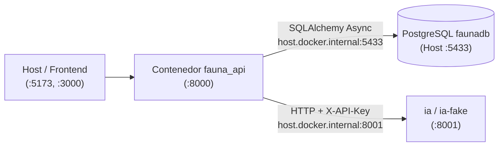

# Documentación General del Backend — Fauna Monitoring API (WWF)

> [!NOTE]
> Base de datos y seeder: [[base_de_datos/README]] | Backlog M0–M4: [[../Analisis_Backend_3.0_WWF_2026-11-15/10_Backlog_Teamwork_WWF]] | Rutina con agentes: [[../Analisis_Backend_3.0_WWF_2026-11-15/12_Guia_Rutina_Implementacion_con_Agentes]]

Este documento resume la topología real en desarrollo, el manejo de variables de entorno entre **desarrollo** y **producción**, y el flujo de inicialización y poblado de base de datos con Docker.

---

## 1. Arquitectura en Desarrollo (2 Contenedores Docker + PostgreSQL)

En el entorno de desarrollo actual operan **2 contenedores Docker** comunicados con PostgreSQL en el host:

| Contenedor / Servicio | Imagen | Puerto Host → Contenedor | Función |
| :--- | :--- | :--- | :--- |
| `fauna_api` (`api`) | `fauna-monitoring-api:local` | `8000 -> 8000` | Backend FastAPI con recarga en caliente (`uvicorn app.main:app --host 0.0.0.0 --port 8000 --reload`). |
| Servicio IA objetivo (`../ia-clasificacion-fauna`) | `ia` (`api/`) o `ia-fake` (`fake/`) | `8001 -> 8001` | Microservicio IA real / simulado alineado al contrato v2 (`POST /api/v1/detect`, `/health`, `/catalog`). |
| `wwf-wildlife-api` *(legado transitorio)* | `wwf-wildlife-detection:latest` | `8081 -> 8000` | Contenedor previo aún levantado mientras se realinea `SPIKE-01` hacia `:8001`. |
| PostgreSQL (`faunadb`) | PostgreSQL en host Windows | `5433` | Motor de base de datos de desarrollo; los contenedores se conectan vía `host.docker.internal:5433`. |



---

## 2. Configuraciones por Variables de Entorno (`development` vs `production`)

El sistema utiliza una **única clase `Settings`** (`app/core/config.py`) alimentada exclusivamente por **variables de entorno**. Ambos entornos comparten la misma estructura de variables, pero **sus credenciales, hosts y reglas de seguridad son completamente distintas**:

| Variable | Perfil `development` (Docker / Local) | Perfil `production` (PaaS / Servidor) |
| :--- | :--- | :--- |
| `ENVIRONMENT` | `development` | `production` |
| `DATABASE_URL` | `postgresql+asyncpg://<DB_USER>:<DB_PASSWORD>@host.docker.internal:5433/faunadb` | `postgresql+asyncpg://<PROD_USER>:<PROD_PASSWORD>@<PROD_HOST>:<PORT>/<PROD_DB>?ssl=require` |
| `AI_SERVICE_URL` | `http://host.docker.internal:8001` (`../ia-clasificacion-fauna` o `ia-fake`; legado `:8081`) | URL interna o privada del servicio de IA en producción (`http://ia:8001`) |
| `AI_API_KEY` | `dev-key` (aceptada en desarrollo) | Clave secreta exclusiva de producción |
| `SECRET_KEY` | Clave de desarrollo ≥ 32 bytes (en `.env` local) | Clave criptográfica aleatoria exclusiva de prod (≥ 32 bytes) |
| `REFRESH_SECRET_KEY` | Clave de desarrollo ≥ 32 bytes, distinta a `SECRET_KEY` | Clave criptográfica aleatoria exclusiva de prod (≥ 32 bytes) |
| `ALLOWED_ORIGINS` | `http://localhost:5173,http://localhost:3000` | Dominios HTTPS reales del frontend (sin `localhost`) |

> [!WARNING]
> **Regla innegociable:** Ningún secreto, contraseña, token o API key se escribe en código Python, scripts (`check_db.py`, `seed_db.py`) ni manifiestos (`digitalocean.yaml`, `koyeb.yml`). `.env` nunca se versiona en Git.

---

## 3. Inicialización y Poblado en Docker (PowerShell)

Dado que `.dockerignore` excluye `seed_db.py`, `seed_massive.py` y `check_db.py` de la imagen de `fauna_api` (mientras mantiene `migrations/`), las operaciones sobre la BD se inyectan por `stdin` al contenedor en ejecución (`docker compose exec -T api python -`).

### Paso 1 · Crear tablas en `faunadb`

```powershell
@'
import asyncio
import app.models
from app.db.session import engine
from app.models.base import Base

async def init_db():
    async with engine.begin() as conn:
        await conn.run_sync(Base.metadata.create_all)
    await engine.dispose()
    print("Tablas creadas correctamente en faunadb.")

asyncio.run(init_db())
'@ | docker compose exec -T api python -
```

### Paso 2 · Confirmar las 10 tablas en PostgreSQL

```powershell
@'
import asyncio
from sqlalchemy import text
from app.db.session import engine

async def check():
    async with engine.connect() as conn:
        res = await conn.execute(text("SELECT tablename FROM pg_tables WHERE schemaname = 'public' ORDER BY tablename"))
        print([r[0] for r in res.fetchall()])
    await engine.dispose()

asyncio.run(check())
'@ | docker compose exec -T api python -
```

Tablas verificadas:
`['anon_sessions', 'camera_stations', 'individuals', 'media_files', 'project_stations', 'projects', 'reports', 'species', 'users', 'videos']`

### Paso 3 · Poblar datos de prueba con `seed_db.py`

```powershell
Get-Content .\seed_db.py -Raw | docker compose exec -T api python -
```

### Paso 4 · Verificar conteos por tabla

```powershell
@'
import asyncio
from sqlalchemy import text
from app.db.session import engine

async def verify():
    tables = ["users", "projects", "camera_stations", "project_stations", "media_files", "videos", "species"]
    async with engine.connect() as conn:
        for t in tables:
            count = (await conn.execute(text(f"SELECT COUNT(*) FROM {t}"))).scalar()
            print(f"{t}: {count} filas")
    await engine.dispose()

asyncio.run(verify())
'@ | docker compose exec -T api python -
```

---

## 4. Ruta de Evolución e Implementación con Agentes

Para llevar el backend desde el estado actual (MVP v4; PR #1 `BUG-01`, PR #2 `BUG-02`, PR #3 `BUG-03` cerrados y PR #4 `SPIKE-01` v0 en realineación a `:8001`) hasta el cumplimiento completo de los contratos y seguridad en producción, consulta la carpeta `Analisis_Backend_3.0_WWF_2026-11-15/`:

1. [Backlog M0–M4 para Teamwork](file:///c:/Users/contr/Documents/Repositorios%20de%20Git/INNOVAHACK/BACKWWF/Analisis_Backend_3.0_WWF_2026-11-15/10_Backlog_Teamwork_WWF.md)
2. [To-Do List por oleadas `/teamwork`](file:///c:/Users/contr/Documents/Repositorios%20de%20Git/INNOVAHACK/BACKWWF/Analisis_Backend_3.0_WWF_2026-11-15/11_Teamwork_Todolist_WWF.md)
3. [Guía de Rutina paso a paso con agentes](file:///c:/Users/contr/Documents/Repositorios%20de%20Git/INNOVAHACK/BACKWWF/Analisis_Backend_3.0_WWF_2026-11-15/12_Guia_Rutina_Implementacion_con_Agentes.md)
4. [Definition of Done Único](file:///c:/Users/contr/Documents/Repositorios%20de%20Git/INNOVAHACK/BACKWWF/Analisis_Backend_3.0_WWF_2026-11-15/DEFINITION_OF_DONE.md)
