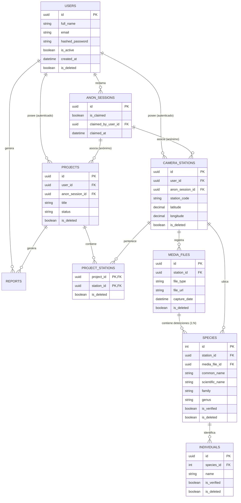

# 🗄️ Documentación de Base de Datos - Fauna Monitoring API (WWF)

## 📌 Visión General del Modelo Relacional Estandarizado

La base de datos está diseñada relacionalmente en **PostgreSQL** (gestionada mediante SQLAlchemy Async ORM) para almacenar y gestionar los datos del monitoreo de fauna silvestre.

Todos los modelos de la base de datos heredan de una clase base común **`BaseEntity`** para estandarizar la auditoría de registros y la estrategia de borrado lógico (**Soft Delete**).

---

## 🛡️ Estructura Base: `BaseEntity`

Todas las tablas heredan los siguientes atributos estándar:

| Campo | Tipo de Dato | Propiedades | Descripción |
| :--- | :--- | :--- | :--- |
| **`id`** | `UUID` / `Integer` | `Primary Key` | Identificador único del registro. |
| **`created_at`** | `DateTime(timezone=True)` | `Default: UTC Now` | Fecha y hora de creación del registro. |
| **`updated_at`** | `DateTime(timezone=True)` | `Default: UTC Now`, `OnUpdate: UTC Now` | Fecha y hora de última modificación. |
| **`is_deleted`** | `Boolean` | `Default: False`, `Index` | Indicador de borrado lógico (Soft Delete). |
| **`deleted_at`** | `DateTime(timezone=True)` | `Nullable` | Fecha y hora en la que fue marcado como eliminado. |

> [!IMPORTANT]
> **Regla Global de Negocio (Soft Delete):**
> Por defecto, todas las consultas y listados en la API aplican el filtro automático `is_deleted IS False` (`deleted_at IS NULL`). Los registros borrados no se eliminan físicamente de la base de datos.

---

## 📊 Tablas del Sistema

### 1. `users` (Usuarios del Sistema)
- **`id`** *(UUID, PK)*: Identificador único.
- **`full_name`** *(String, Not Null)*: Nombre completo del usuario.
- **`email`** *(String, Unique, Index, Not Null)*: Correo electrónico.
- **`hashed_password`** *(String, Not Null)*: Contraseña encriptada (bcrypt/argon2).
- **`institucion`** *(String, Nullable)*: Organización o institución.
- **`sexo`** *(String, Nullable)*: Género o sexo.
- **`is_active`** *(Boolean, Default True)*: Estado de la cuenta.
- **Campos `BaseEntity`**: `created_at`, `updated_at`, `is_deleted`, `deleted_at`.

---

### 2. `anon_sessions` (Sesiones Anónimas)
- **`id`** *(UUID, PK)*: Identificador único de la sesión anónima (`anon_session_id`).
- **`is_claimed`** *(Boolean, Default False)*: Indica si los datos de esta sesión ya fueron reclamados por un usuario registrado.
- **`claimed_by_user_id`** *(UUID, FK -> `users.id`, Nullable)*: Usuario que reclamó la sesión.
- **`claimed_at`** *(DateTime, Nullable)*: Fecha en que se realizó el reclamo.
- **Campos `BaseEntity`**: `created_at`, `updated_at`, `is_deleted`, `deleted_at`.

---

### 3. `projects` (Proyectos de Investigación)
- **`id`** *(UUID, PK)*: Identificador único del proyecto.
- **`user_id`** *(UUID, FK -> `users.id`, Nullable)*: Propietario del proyecto (si fue creado autenticado o reclamado).
- **`anon_session_id`** *(UUID, FK -> `anon_sessions.id`, Nullable)*: Identificador de sesión anónima si fue creado sin cuenta.
- **`title`** *(String, Not Null)*: Título del proyecto.
- **`description`** *(Text, Nullable)*: Descripción.
- **`objectives`** *(Text, Nullable)*: Objetivos.
- **`expected_results`** *(Text, Nullable)*: Resultados esperados.
- **`status`** *(String, Default 'public')*: Estado del proyecto (`public`, `private`, `archived`).
- **`colaborators`** *(JSON / ARRAY de UUIDs)*: Lista de IDs de colaboradores.
- **Campos `BaseEntity`**: `created_at`, `updated_at`, `is_deleted`, `deleted_at`.

---

### 4. `camera_stations` (Estaciones de Cámaras Trapa)
- **`id`** *(UUID, PK)*: Identificador único de la estación.
- **`user_id`** *(UUID, FK -> `users.id`, Nullable)*: Usuario propietario (si autenticado o reclamado).
- **`anon_session_id`** *(UUID, FK -> `anon_sessions.id`, Nullable)*: Sesión anónima (si fue creada sin cuenta).
- **`station_code`** *(String, Index, Not Null)*: Código identificador (e.g., `CAM-01`).
- **`location_name`** *(String, Nullable)*: Nombre del sitio/ubicación.
- **`latitude`** / **`longitude`** *(Numeric/Decimal, Nullable)*: Coordenadas GPS.
- **`altitude_meters`** *(Numeric/Decimal, Nullable)*: Altitud en metros.
- **`camera_brand`** / **`camera_model`** / **`serial_number`** *(String, Nullable)*: Especificaciones.
- **`trigger_speed_ms`** / **`ir_range_meters`** *(Integer, Nullable)*: Parámetros técnicos.
- **`days_active`** *(Integer, Nullable)*: Días proyectados o transcurridos de actividad.
- **`deployment_date`** / **`retrieval_date`** *(Date, Nullable)*: Fechas de instalación y retiro.
- **`status`** *(String, Default 'active')*: Estado (`active`, `maintenance`, `retrieved`).
- **`meta_data`** *(JSON, Nullable)*: Variables ambientales adicionales.
- **Campos `BaseEntity`**: `created_at`, `updated_at`, `is_deleted`, `deleted_at`.

---

### 5. `project_stations` (Tabla Intermedia N:M Proyectos <-> Estaciones)
- **`project_id`** *(UUID, FK -> `projects.id`, PK)*
- **`station_id`** *(UUID, FK -> `camera_stations.id`, PK)*
- **Campos `BaseEntity`**: `created_at`, `updated_at`, `is_deleted`, `deleted_at`.

---

### 6. `media_files` (Archivos Multimedia: Videos e Imágenes)
- **`id`** *(UUID, PK)*: Identificador único del archivo.
- **`station_id`** *(UUID, FK -> `camera_stations.id`, Not Null)*: Estación de origen.
- **`file_type`** *(String, Not Null)*: Tipo de medio (`video` | `image`).
- **`file_url`** *(String, Not Null)*: Ruta local o URL remota del archivo original.
- **`original_filename`** *(String, Nullable)*: Nombre de archivo original.
- **`duration_seconds`** *(Integer, Nullable)*: Duración en segundos (para videos).
- **`file_size_mb`** *(Numeric/Decimal, Nullable)*: Peso del archivo en MB.
- **`capture_date`** *(DateTime, Nullable)*: Fecha/hora de captura original.
- **`metadata_extra`** *(JSON, Nullable)*: Metadatos técnicos (resolución, codec, EXIF/FFmpeg).
- **Campos `BaseEntity`**: `created_at`, `updated_at`, `is_deleted`, `deleted_at`.

---

### 7. `species` (Detecciones de Fauna)
- **`id`** *(Integer, PK, Autoincremental)*
- **`station_id`** *(UUID, FK -> `camera_stations.id`, Not Null)*
- **`media_file_id`** *(UUID, FK -> `media_files.id`, Nullable)*: Archivo multimedia origen.
- **`common_name`** *(String, Index, Not Null)*: Nombre común.
- **`scientific_name`** *(String, Nullable)*: Nombre científico (*Género especie*).
- **`family`** *(String, Nullable)*: Familia taxonómica (e.g. *Felidae*).
- **`genus`** *(String, Nullable)*: Género taxonómico (e.g. *Panthera*).
- **`confidence_score`** *(Numeric/Decimal, Nullable)*: Score de confianza IA (0.00 a 1.00).
- **`detection_timestamp`** *(DateTime, Nullable)*: Fecha/hora exacta del frame/crop.
- **`url_img`** *(String, Nullable)*: URL del recorte (*crop/frame*) específico.
- **`is_verified`** *(Boolean, Nullable)*: Verificación por biólogo experto.
- **Campos `BaseEntity`**: `created_at`, `updated_at`, `is_deleted`, `deleted_at`.

---

### 8. `individuals` (Catálogo de Individuos)
- **`id`** *(UUID, PK)*
- **`species_id`** *(Integer, FK -> `species.id`, Nullable)*
- **`name`** *(String, Not Null)*: Nombre o código de identificación individual.
- **`is_verified`** *(Boolean, Nullable)*
- **Campos `BaseEntity`**: `created_at`, `updated_at`, `is_deleted`, `deleted_at`.

---

### 9. `reports` (Informes y Métricas)
- **`id`** *(UUID, PK)*
- **`project_id`** *(UUID, FK -> `projects.id`)*
- **`user_id`** *(UUID, FK -> `users.id`, Nullable)*
- **`title`** *(String, Nullable)*
- **`report_data`** *(JSON, Not Null)*
- **`applied_filters`** *(JSON, Not Null)*
- **Campos `BaseEntity`**: `created_at`, `updated_at`, `is_deleted`, `deleted_at`.

---

## 🔗 Diagrama Entidad-Relación (Mermaid)



---

## 🔄 Gestión de Migraciones con Alembic

A partir de la versión 4.0, el esquema de la base de datos se gestiona formalmente mediante **Alembic** con soporte asíncrono (`SQLAlchemy 2.0` + `asyncpg`).

### Comandos de Gestión de Migraciones

1. **Crear una nueva migración automáticamente tras modificar modelos:**
   ```bash
   alembic revision --autogenerate -m "nombre_del_cambio"
   ```

2. **Aplicar todas las migraciones pendientes:**
   ```bash
   alembic upgrade head
   ```

3. **Revertir la última migración aplicada (Rollback):**
   ```bash
   alembic downgrade -1
   ```

4. **Sincronizar una base de datos existente sin re-ejecutar:**
   ```bash
   alembic stamp head
   ```

