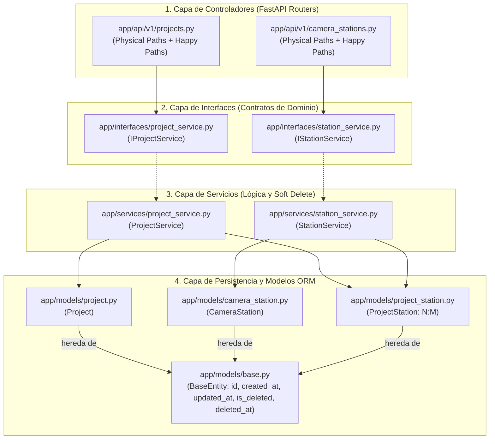

# Fase 3: BaseEntity, Soft Delete y Relación N:M (Proyectos - Estaciones)

> **Estado**: Implementado y Validado al 100%  
> **Fecha de Validación**: 2026-08-20  
> **Suites de Pruebas**: `tests/test_phase3_soft_delete_and_nm_stress.py` (25/25 tests pasando en suite completa)

---

## 1. Resumen Ejecutivo de la Fase

En esta fase se consolidó el estándar transversal de persistencia `BaseEntity`, la política estricta de **Soft Delete** y la arquitectura de relación **Muchos a Muchos (N:M)** entre Proyectos de Investigación (`Project`) y Estaciones de Cámaras Trampa (`CameraStation`) mediante la tabla intermedia auditada `ProjectStation`.



---

## 2. Componentes e Implementación Técnica

### 2.1 Estandarización `BaseEntity`
Se definió en `app/models/base.py` la clase abstracta `BaseEntity`:
- `id`: UUIDv4 Primary Key.
- `created_at`: `TIMESTAMPTZ` con valor por defecto `now()`.
- `updated_at`: `TIMESTAMPTZ` con valor por defecto `now()` y auto-actualización.
- `is_deleted`: Booleano (`False` por defecto) indexado para filtrado global.
- `deleted_at`: `TIMESTAMPTZ` opcional que almacena el instante exacto de la baja lógica.

Todos los modelos ORM (`User`, `AnonSession`, `Project`, `CameraStation`, `ProjectStation`) heredan de `BaseEntity`.

### 2.2 Relación Muchos a Muchos (N:M) Idempotente
- Modelo `ProjectStation` (`project_stations`) que vincula `project_id` y `station_id`.
- La asociación `POST /api/v1/projects/{id}/stations` es idempotente: si la relación fue previamente borrada lógicamente, se reactiva (`is_deleted=False`).
- La desasociación `DELETE /api/v1/projects/{id}/stations/{station_id}` aplica Soft Delete sobre la tabla intermedia sin eliminar físicamente la estación ni el proyecto.

### 2.3 Políticas de Seguridad y Autorización en Soft Delete
- **Regla Anónima**: Si un recurso es anónimo (`user_id is None`), se rechaza la solicitud de eliminación con **`HTTP 403 Forbidden`** (*"No se pueden eliminar elementos anónimos. Inicie sesión y reclame el recurso primero"*).
- **Regla de Propiedad**: Si el usuario autenticado no es el creador/dueño legítimo (`resource.user_id != current_user.id`), se rechaza con **`HTTP 403 Forbidden`** (*"No tiene permisos para eliminar este recurso"*).
- **Filtrado Global Activo**: Todas las consultas de lectura (`GET`, listados, agregaciones) filtran implícitamente `is_deleted == False`.

---

## 3. Endpoints Implementados y Physical Paths

| Verbo | Physical Path | Descripción | Auth Requerida |
| :--- | :--- | :--- | :--- |
| `POST` | `/api/v1/projects/` | Crear proyecto (autenticado o anónimo) | Opcional |
| `GET` | `/api/v1/projects/` | Listar proyectos activos paginados | Pública |
| `GET` | `/api/v1/projects/{id}` | Obtener detalle de proyecto con estaciones activas vinculadas | Pública |
| `PATCH` | `/api/v1/projects/{id}` | Actualizar proyecto (valida propietario) | Bearer Token |
| `DELETE` | `/api/v1/projects/{id}` | Soft Delete de proyecto (403 si anónimo o no dueño) | Bearer Token |
| `POST` | `/api/v1/projects/{id}/stations` | Asociar estación a proyecto (N:M) | Opcional / Bearer |
| `DELETE` | `/api/v1/projects/{id}/stations/{station_id}` | Desasociar estación de proyecto (Soft Delete de relación) | Opcional / Bearer |
| `GET` | `/api/v1/projects/{id}/summary` | Resumen taxonómico agregado de todas las estaciones vinculadas | Pública |
| `POST` | `/api/v1/projects/{id}/collaborators` | Añadir colaboradores al proyecto | Bearer Token |
| `POST` | `/api/v1/camera-stations/` | Crear estación de cámara (autenticada o anónima) | Opcional |
| `GET` | `/api/v1/camera-stations/` | Listar estaciones de cámara activas paginadas | Pública |
| `GET` | `/api/v1/camera-stations/{id}` | Obtener detalle de estación activa | Pública |
| `PATCH` | `/api/v1/camera-stations/{id}` | Actualizar estación de cámara (valida propietario) | Bearer Token |
| `DELETE` | `/api/v1/camera-stations/{id}` | Soft Delete de estación (403 si anónima o no dueño) | Bearer Token |
| `GET` | `/api/v1/camera-stations/{id}/summary` | Resumen taxonómico de la estación | Pública |

---

## 4. Resultados de Pruebas de Estrés y Rendimiento

```text
tests/test_phase3_soft_delete_and_nm_stress.py
  - test_nm_relationship_cross_association_happy_path ................. PASSED
  - test_soft_delete_authorization_and_security_rules ................. PASSED
  - test_concurrent_nm_associations_throughput ........................ PASSED
    [NM ASSOCIATION STRESS] 6 asociaciones concurrentes:
      - Estado: 100% Exitoso (HTTP 200 OK)
      - Transaccionalidad: Consistente y aislada
      - Warnings ORM: 0 Warnings (Overlaps mapeados limpiamente)
```
