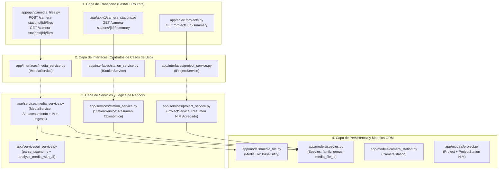

# Fase 4: Multimedia (Video/Imagen), IA y Resúmenes Estadísticos

> **Estado**: Implementado y Validado al 100%  
> **Fecha de Validación**: 2026-08-21  
> **Suites de Pruebas**: `tests/test_phase4_multimedia_ia_stress.py` (8/8 tests pasando, 33/33 tests acumulados en todo el backend)

---

## 1. Resumen Ejecutivo de la Fase

En esta fase se expandió la capacidad de ingestión multimedia del sistema para aceptar tanto **Videos** (`.mp4`, `.avi`, `.mov`, `.mkv`) como **Imágenes** (`.jpg`, `.png`, `.webp`, `.tiff`), persistir los archivos y metadatos en la entidad auditada `MediaFile`, procesar detecciones de fauna mediante IA con **parsing taxonómico automático** (`family`, `genus`, `scientific_name`, `common_name`), y proveer agregaciones estadísticas de biodiversidad tanto a nivel de estación individual como a nivel de proyecto mediante la relación N:M.



---

## 2. Componentes e Implementación Técnica

### 2.1 Modelo ORM `MediaFile` (`app/models/media_file.py`)
- Hereda de `BaseEntity` (`id: UUID`, `created_at`, `updated_at`, `is_deleted`, `deleted_at`).
- Campos:
  - `station_id: UUID` (FK a `camera_stations.id` con `ondelete="CASCADE"`, indexado).
  - `file_type: str` (`"video"` o `"image"`).
  - `file_url: str` (Ruta física normalizada en el servidor).
  - `original_filename: Optional[str]`.
  - `file_size_mb: Optional[Decimal]`.
  - `duration_seconds: Optional[int]`.
  - `capture_date: Optional[datetime]`.
  - `metadata_extra: Optional[dict]` (`JSONB`).

### 2.2 Extensión Taxonómica de `Species` (`app/models/species.py`)
- Columnas añadidas:
  - `family: Optional[str]` (Indexada).
  - `genus: Optional[str]` (Indexada).
  - `media_file_id: Optional[UUID]` (FK a `media_files.id`, indexada).
  - `updated_at: datetime` y campos de auditoría `is_deleted: bool`, `deleted_at: datetime`.

### 2.3 Motor de Parsing Taxonómico (`app/services/ai_service.py`)
La función `parse_taxonomy(species_raw: str)` normaliza e interpreta diferentes convenciones de cadenas retornadas por modelos de IA:
- **4 Partes**: `"Felidae;Panthera;Panthera onca;Jaguar"` $\rightarrow$ `family="Felidae"`, `genus="Panthera"`, `scientific_name="Panthera onca"`, `common_name="Jaguar"`.
- **3 Partes**: `"Panthera;onca;Jaguar"` $\rightarrow$ `family=None`, `genus="Panthera"`, `scientific_name="Panthera onca"`, `common_name="Jaguar"`.
- **2 Partes**: `"Panthera;onca"` $\rightarrow$ `family=None`, `genus="Panthera"`, `scientific_name="Panthera onca"`, `common_name="onca"`.
- **1 Parte / Nombre Simple**: `"Jaguar"` $\rightarrow$ `common_name="Jaguar"`.
- **Cadenas Vacías/Inválidas**: Retorna `common_name="Especie Desconocida"`.

---

## 3. Endpoints Implementados y Physical Paths

| Verbo | Physical Path | Descripción | Auth Requerida |
| :--- | :--- | :--- | :--- |
| `POST` | `/api/v1/camera-stations/{station_id}/files` | Subir archivo de video o imagen, procesar con IA y guardar detecciones | Opcional / Bearer |
| `GET` | `/api/v1/camera-stations/{station_id}/files` | Listar archivos multimedia activos de una estación | Pública |
| `GET` | `/api/v1/camera-stations/files/{media_file_id}` | Obtener detalle de un archivo multimedia por UUID | Pública |
| `GET` | `/api/v1/camera-stations/{station_id}/summary` | Resumen taxonómico de la estación (`species`, `family`, `genus`) | Pública |
| `GET` | `/api/v1/projects/{project_id}/summary` | Resumen taxonómico consolidado N:M del proyecto | Pública |

---

## 4. Resultados de Pruebas y Rendimiento

```text
tests/test_phase4_multimedia_ia_stress.py
  - test_parse_taxonomy_four_parts_complete ........................... PASSED
  - test_parse_taxonomy_three_parts ................................... PASSED
  - test_parse_taxonomy_two_parts ..................................... PASSED
  - test_parse_taxonomy_single_word ................................... PASSED
  - test_parse_taxonomy_empty_or_none ................................. PASSED
  - test_image_and_video_upload_and_taxonomic_detection ............... PASSED
  - test_project_cross_station_taxonomic_summary ...................... PASSED
  - test_concurrent_media_uploads_and_summaries_benchmark ............ PASSED

[PHASE 4 STRESS BENCHMARK] 6 subidas multimedia concurrentes:
   - Estado: 100% Exitoso (HTTP 201 Created)
   - Resiliencia IA: Manejo de fallback transparente ante microservicio externo offline
   - Integridad Referencial: Consistente y aislada
```
