# Fase 5: Verificación, Pruebas Integrales y Despliegue

> **Estado**: Implementado y Validado al 100%  
> **Fecha de Validación**: 2026-08-21  
> **Suites de Pruebas**: `tests/test_phase5_integration_and_deployment.py` (5/5 tests pasando, 38/38 tests acumulados en todo el backend)

---

## 1. Resumen Ejecutivo de la Fase

La **Fase 5** culmina la arquitectura del Backend de Monitoreo WWF consolidando la verificación de extremo a extremo (E2E) de todo el ciclo de vida del sistema, asegurando el cumplimiento de los estándares OpenAPI 3.1 / Swagger UI con autorización interactiva `HTTPBearer`, e implementando los artefactos de contenedorización y orquestación Cloud (`Dockerfile`, `docker-compose.yml`, `koyeb.yml`).

```mermaid
flowchart TD
    subgraph E2E ["1. Ciclo de Vida Extremo a Extremo (E2E Flow)"]
        S1["1. Ingesta Anónima<br/>(Header X-Anon-Session-ID)"]
        S2["2. Bloqueo 403 Soft Delete Anónimo<br/>(Protección de integridad)"]
        S3["3. Registro & Login JWT<br/>(Tokens de Acceso y Refresco)"]
        S4["4. Reclamo de Recursos<br/>(POST /users/me/claim)"]
        S5["5. Subida Multimedia & IA<br/>(Detección Taxonómica)"]
        S6["6. Soft Delete Autorizado<br/>(200 OK + is_deleted=True)"]
        S7["7. Exclusión en Consultas<br/>(is_deleted=False en GET/List)"]
    end

    subgraph Plataforma ["2. Plataforma, Salud y Despliegue"]
        H1["GET /health<br/>(Estado de servicio y DB)"]
        H2["GET /<br/>(Metadatos de versión y docs)"]
        DOCS["Swagger UI / OpenAPI<br/>(Esquema BearerAuth JWT)"]
        DOCK["Docker Multi-Stage<br/>(ffmpeg + non-root appuser)"]
    end

    S1 --> S2
    S2 --> S3
    S3 --> S4
    S4 --> S5
    S5 --> S6
    S6 --> S7
    H1 -.-> DOCS
    H2 -.-> DOCS
    DOCS -.-> DOCK
```



---

## 2. Componentes e Implementación Técnica

### 2.1 Endpoints de Salud y Metadatos del Sistema (`app/main.py`)
- **`GET /health`**:
  - Verifica conectividad directa asíncrona con el motor PostgreSQL (`SELECT 1`).
  - Retorna `status: "healthy"`, `database: "connected"`, `version: "4.0.0"`.
- **`GET /`**:
  - Retorna metadatos de la aplicación, entorno (`production`/`development`), versión y enlaces directos a `/docs` y `/redoc`.

### 2.2 Configuración Interactiva OpenAPI / Swagger UI
- Esquema de seguridad `HTTPBearer` inyectado dinámicamente en `custom_openapi()`.
- Habilita el botón **Authorize** en `http://localhost:8000/docs` para autenticar peticiones interactivas con tokens JWT Bearer.
- Parámetro `persistAuthorization=True` para preservar el token en la sesión del navegador.

### 2.3 Artefactos de Despliegue y Contenedorización

#### Dockerfile Multi-Stage de Producción
- **Stage 1 (Builder)**: Instalación y compilación de dependencias con wheel caching en `/install`.
- **Stage 2 (Final)**: Imagen base `python:3.11-slim` limpia sin compiladores `gcc`, con binarios de `ffmpeg` y `curl`.
- Creación de carpetas de almacenamiento `/code/uploads/videos` y `/code/uploads/images`.
- Usuario no privilegiado `appuser` (UID no-root) para cumplimiento de seguridad en contenedores.
- Directiva `HEALTHCHECK` nativa consultando `GET /health`.

#### Configuración de Orquestación Koyeb / Docker Compose
- [koyeb.yml](file:///c:/Users/contr/Documents/Repositorios%20de%20Git/INNOVAHACK/BACKWWF/koyeb.yml): Definición de servicio web con healthcheck en `/health`, puerto `8000` y escala flexible.
- [docker-compose.yml](file:///c:/Users/contr/Documents/Repositorios%20de%20Git/INNOVAHACK/BACKWWF/docker-compose.yml): Entorno de desarrollo local con volumen persistente en `./uploads` y hot-reload.

---

## 3. Endpoints del Sistema y Physical Paths

| Verbo | Physical Path | Descripción | Auth Requerida | Formato Respuesta |
| :--- | :--- | :--- | :--- | :--- |
| `GET` | `/health` | Chequeo de salud del servicio y base de datos | Pública | `StandardResponse` |
| `GET` | `/` | Información y estado del servicio | Pública | `StandardResponse` |
| `GET` | `/docs` | Interfaz interactiva Swagger UI | Pública | HTML |
| `GET` | `/openapi.json` | Esquema formal OpenAPI 3.1 con BearerAuth | Pública | JSON |

---

## 4. Resultados de Pruebas Integrales y Benchmarks

### Script de Flujo de Negocio (`scratch/test_flow.py`)
```text
[1/8] Verificando Estado de Salud del Backend (/health) ........ [OK] healthy, DB connected
[2/8] Probando Creacion Anonima de Estacion .................... [OK] Genera X-Anon-Session-ID
[3/8] Registrando Usuario Nuevo e Iniciando Sesion ............. [OK] Bearer JWT generado
[4/8] Validando Bloqueo de Soft Delete Anonimo ................. [OK] HTTP 403 Forbidden
[5/8] Reclamando Datos Anonimos a la Cuenta Autenticada ........ [OK] Transferencia exitosa
[6/8] Subiendo Archivo Multimedia y Procesando con IA .......... [OK] Ingesta y Detecciones IA
[7/8] Ejecutando Soft Delete como Propietario Autenticado ...... [OK] HTTP 200 OK
[8/8] Verificando Filtro de Soft Delete en Listados ............ [OK] 404 en consulta directa
>>> TODOS LOS PASOS DEL FLUJO INTEGRAL E2E FUERON EXITOSOS <<<
```

### Suite de Pruebas Automatizadas (`tests/test_phase5_integration_and_deployment.py`)
```text
tests/test_phase5_integration_and_deployment.py
  - test_health_check_endpoint ........................................ PASSED
  - test_root_endpoint_metadata ....................................... PASSED
  - test_openapi_schema_and_bearer_security ........................... PASSED
  - test_full_system_lifecycle_e2e .................................... PASSED
  - test_concurrent_health_and_system_benchmark ....................... PASSED

[PHASE 5 STABILITY BENCHMARK] 20 peticiones concurrentes a /health:
   - Throughput (RPS): 3.29 op/seg
   - Latencias: p50=4592.92ms | p95=6058.41ms | p99=6058.41ms
   - Tasa de Error: 0.0%
```
